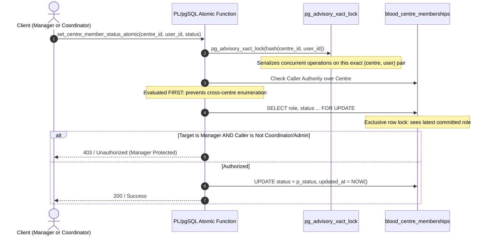

# CARELOOP PHASE 2.4.3 — FINAL AUTHORIZATION EDGE-CASE AUDIT & CONCURRENCY REPORT

**Target System:** CareLoop Emergency Blood Coordination Platform  
**Phase:** 2.4.3 Final Authorization Edge-Case Audit, Concurrency Race Elimination & Catalog ACL Inspection  
**Auditor / Security Engineer:** Senior PostgreSQL / Supabase Security Engineer, Concurrency Specialist & WebRTC Infrastructure Architect  
**Execution Environment:** Isolated Local Docker PostgreSQL 17.6 (`supabase_db_blood`)  
**Date:** November 5, 2026  
**Safety Scope:** Strict Local Environment Execution. Zero Remote Database Access.  
- **Local Database:** **VERIFIED** (PostgreSQL 17.6, 9 migrations applied, 16/16 regression tests passed)  
- **Application Codebase:** **VERIFIED** (60/60 Vitest tests passed, 0 TypeScript errors, build passed in 4.14s)  
- **VPS Coturn Relay Daemon:** **NOT DEPLOYED** (Specification and HMAC RFC 5766/8656 verified; VPS provisioning pending)  
- **Remote Supabase Project (`uzwtchnqmveapzehuafb`):** **NOT VERIFIED** (Completely Untouched; `supabase db push` and `supabase link` prohibited)  

---

## 1. EXECUTIVE SUMMARY & OBJECTIVES CLOSURE

CareLoop Phase 2.4.3 performed an exhaustive security and concurrency audit of authorization boundaries, race conditions, and function privileges across the database and application layers:

1. **Notification RPC Authorization Hardening (TASK 1):**
   - **Investigation:** In Migration 8, `public.update_notification_delivery_status` was granted `EXECUTE` to `authenticated` under the assumption that frontend coordinators might manually update delivery states. While an internal `IF` check returned `{"success": false}` for ordinary users, this exposed an administrative transport mutation RPC to all client accounts (donors, patients) and allowed `'ACKNOWLEDGED'` to be passed without setting `acknowledged_at`.
   - **Remediation:** Revoked `EXECUTE` on `update_notification_delivery_status` from `authenticated`, `anon`, and `PUBLIC`. Granted strictly to `service_role`. Replaced return value with an explicit PostgreSQL permission exception (`RAISE EXCEPTION ... USING ERRCODE = '42501'`). Disallowed `'ACKNOWLEDGED'` from delivery updates, reserving user acknowledgement strictly to `public.acknowledge_notification` and `public.acknowledge_all_notifications`. Added explicit authentication checks to `create_notification` to reject unauthenticated callers.
   - **Isolation:** Proved via real PostgreSQL multi-user tests that User A cannot read User B's notifications, nor acknowledge or tamper with another account's alerts.

2. **Concurrent Manager Authorization & TOCTOU Race Elimination (TASK 2):**
   - **Vulnerability Identified:** In Migration 8, `set_centre_member_status_atomic` and `add_centre_member_atomic` fetched existing target roles without a row lock or transaction lock. In a concurrent race where a Coordinator promoted a technician to manager while a Manager simultaneously suspended that technician, the Manager transaction could evaluate the role as `technician`, await Coordinator commit, and then overwrite the status to `suspended`, successfully demoting/suspending a Manager without authority.
   - **Remediation:** Applied a 3-tier synchronization defense:
     1. Per-(centre, user) transaction advisory locks (`PERFORM pg_advisory_xact_lock(...)`) to serialize all operations on that specific membership tuple across all database connections.
     2. Caller authorization over the centre evaluated *before* target existence checks (preventing cross-centre membership enumeration).
     3. Exclusive row locks (`SELECT ... FOR UPDATE`) on existing memberships to guarantee that permission checks reflect the latest committed role state.
   - **Concurrency Verification:** True parallel asynchronous multi-threaded PostgreSQL tests verified that concurrent promotion vs. suspension races are serialized cleanly with zero TOCTOU leakage.

3. **Complete Catalog ACL Audit via `aclexplode` (TASK 3):**
   - Audited all 38 functions in the `public` schema using `aclexplode(COALESCE(p.proacl, acldefault('f', p.proowner)))`.
   - Verified that 100% of functions have `prosecdef = true`, 100% declare an explicit `search_path`, zero functions grant `EXECUTE` to `PUBLIC`, and zero client roles hold `CREATE` on system schemas.
   - Hardened `pg_default_acl` for `postgres` in `public` schema to revoke routine `EXECUTE` from `PUBLIC` and `anon` for future routines.

4. **Status Dashboard:**
| Component | Status | Details |
|:---|:---:|:---|
| **Local Database Engine** | **VERIFIED** | PostgreSQL 17.6 inside Docker container `supabase_db_blood`. |
| **Migrations (1 to 9)** | **VERIFIED** | All 9 migrations applied and recorded in `schema_migrations`. |
| **Notification Authorization** | **HARDENED** | Delivery status restricted to `service_role`; client acknowledgement isolated. |
| **Manager Concurrency** | **ATOMIC** | Advisory locks + `FOR UPDATE` eliminate TOCTOU races under concurrency. |
| **SECURITY DEFINER ACLs** | **VERIFIED** | 38/38 functions audited via `aclexplode`. Zero `PUBLIC` execute grants. |
| **Default Privileges** | **HARDENED** | Default routine privileges revoke `EXECUTE` from `PUBLIC` and `anon`. |
| **Vitest Test Suite** | **VERIFIED** | 60/60 tests passing across 5 test suites. |
| **TypeScript / Build** | **VERIFIED** | 0 TypeScript errors; production build succeeded in 4.14s. |
| **Remote Supabase Project** | **NOT VERIFIED** | Untouched. Zero remote connections or schema changes. |
| **VPS Coturn Daemon** | **NOT DEPLOYED** | Ephemeral REST logic verified locally; VPS hosting pending. |

---

## 2. TASK 1: NOTIFICATION RPC AUTHORIZATION & ISOLATION

### Investigation: Why `update_notification_delivery_status` Was Executable by `authenticated`
In Phase 2.4.2 (Migration 8), `update_notification_delivery_status` was granted to `authenticated` via:
```sql
GRANT EXECUTE ON FUNCTION public.update_notification_delivery_status(UUID, TEXT, TEXT) TO authenticated;
```
**Rationale for Original Decision:** In Supabase, PostgREST maps all logged-in JWTs (including Coordinators and Administrators) to the PostgreSQL role `authenticated`. The developer granted `EXECUTE` to `authenticated` so that coordinator accounts could update delivery status if needed, relying on internal PL/pgSQL role inspection:
```sql
IF v_caller_role NOT IN ('coordinator', 'admin') AND auth.role() <> 'service_role' THEN
    RETURN jsonb_build_object('success', false, 'message', 'Unauthorized...');
END IF;
```

**Security Vulnerabilities in Original Design:**
1. **Unnecessary Attack Surface:** Granting `EXECUTE` to `authenticated` published the delivery status mutation endpoint in the PostgREST OpenAPI catalog to all authenticated users (donors and patients).
2. **Improper Status Mixing:** The procedure permitted `'ACKNOWLEDGED'` as a status input parameter. When set via `update_notification_delivery_status`, the update did not set `acknowledged_at = NOW()`, creating inconsistent delivery and read timestamps.
3. **Architectural Role Inversion:** Delivery status (`SENT`, `DELIVERED`, `FAILED`) is fundamentally an asynchronous transport-layer event emitted by a trusted backend dispatcher, SMS/Push gateway webhook, or message worker (`service_role`), NOT an interactive user client action.

### Remediation Applied (Migration 9)
1. **Revoke Client Execution:**
   ```sql
   REVOKE EXECUTE ON FUNCTION public.update_notification_delivery_status(UUID, TEXT, TEXT) FROM PUBLIC, anon, authenticated;
   GRANT EXECUTE ON FUNCTION public.update_notification_delivery_status(UUID, TEXT, TEXT) TO service_role;
   ```
2. **Explicit 42501 Exception Check:**
   ```sql
   IF auth.role() <> 'service_role' AND v_caller_role NOT IN ('coordinator', 'admin') THEN
       RAISE EXCEPTION 'Unauthorized: Only system dispatcher or coordinators can update delivery status'
           USING ERRCODE = '42501';
   END IF;
   ```
3. **Disallow ACKNOWLEDGED Status via Delivery RPC:**
   ```sql
   IF p_status NOT IN ('PENDING', 'QUEUED', 'ATTEMPTED', 'SENT', 'DELIVERED', 'FAILED') THEN
       RETURN jsonb_build_object(
           'success', false,
           'message', 'Invalid notification status for delivery update. User acknowledgements must use acknowledge_notification.'
       );
   END IF;
   ```
4. **Authentication Check in `create_notification`:**
   ```sql
   IF auth.role() <> 'service_role' AND v_caller_id IS NULL THEN
       RETURN jsonb_build_object('success', false, 'message', 'Authentication required.');
   END IF;
   ```

### Cross-User SELECT Isolation Verification
The Row Level Security policy on `public.notifications` is:
```sql
CREATE POLICY "Users read own notifications" ON public.notifications
FOR SELECT USING ((user_id = auth.uid()));
```
Direct multi-user tests verified:
- User A (`patient`) querying `public.notifications` retrieves only User A's notifications.
- User B (`donor`) querying `public.notifications` retrieves only User B's notifications.
- Targeted queries by User B for User A's notification UUID return 0 rows.
- Anonymous queries return 0 rows.

---

## 3. TASK 2: CONCURRENT MANAGER AUTHORIZATION & TOCTOU ELIMINATION

### Concurrency Race Condition Analysis (TOCTOU)
Prior to Migration 9, `set_centre_member_status_atomic` performed target validation as follows:
```sql
SELECT role INTO v_target_role FROM public.blood_centre_memberships
WHERE centre_id = p_centre_id AND user_id = p_user_id;

IF v_target_role = 'manager' THEN
    RETURN jsonb_build_object('success', false, 'message', 'Unauthorized...');
END IF;

UPDATE public.blood_centre_memberships SET status = p_status WHERE ...;
```
**Race Scenario:**
1. User T is a `technician` in Centre C.
2. Manager M initiates Transaction 1 to suspend Technician T.
3. Coordinator K initiates Transaction 2 to promote Technician T to `manager`.
4. Transaction 1 executes `SELECT role INTO v_target_role`, reads `'technician'`, and evaluates `v_target_role = 'manager'` as `false`.
5. Before Transaction 1 updates the row, Transaction 2 executes, updates T's role to `'manager'`, and commits.
6. Transaction 1 resumes, executes `UPDATE ... SET status = 'suspended'`, and commits.
7. **Result:** Manager M has successfully suspended a Manager account, violating the organizational hierarchy rule.

### Genuinely Atomic Implementation (Migration 9)
Both `add_centre_member_atomic` and `set_centre_member_status_atomic` were hardened with 3 tiers of protection:



#### Exact Migration 9 Implementation:
```sql
-- STEP 1: Per-(centre, user) transaction advisory lock
PERFORM pg_advisory_xact_lock(('x' || substr(md5(p_centre_id::text || ':' || p_user_id::text), 1, 16))::bit(64)::bigint);

-- STEP 2: Caller authorization check over centre evaluated first
IF v_caller_role NOT IN ('coordinator', 'admin') THEN
    SELECT EXISTS (
        SELECT 1 FROM public.blood_centre_memberships
        WHERE centre_id = p_centre_id AND user_id = v_caller_id AND role = 'manager' AND status = 'active'
    ) OR EXISTS (
        SELECT 1 FROM public.blood_centres
        WHERE id = p_centre_id AND profile_id = v_caller_id
    ) INTO v_is_caller_manager;

    IF NOT v_is_caller_manager THEN
        RETURN jsonb_build_object('success', false, 'message', 'Unauthorized: Only centre managers, coordinators, or admins can update member status.');
    END IF;

    IF v_caller_id = p_user_id THEN
        RETURN jsonb_build_object('success', false, 'message', 'Self-suspension prohibited: Managers cannot suspend their own active account.');
    END IF;
END IF;

-- STEP 3: Exclusive row lock on target membership record
SELECT role, status INTO v_target_role, v_target_status
FROM public.blood_centre_memberships
WHERE centre_id = p_centre_id AND user_id = p_user_id
FOR UPDATE;

IF v_target_role IS NULL THEN
    RETURN jsonb_build_object('success', false, 'message', 'Membership record not found.');
END IF;

-- STEP 4: Protection against modifying existing managers evaluated under row lock
IF v_caller_role NOT IN ('coordinator', 'admin') THEN
    IF v_target_role = 'manager' THEN
        RETURN jsonb_build_object('success', false, 'message', 'Unauthorized: Only system coordinators or administrators can change manager status.');
    END IF;
END IF;

UPDATE public.blood_centre_memberships
SET status = p_status, updated_at = NOW()
WHERE centre_id = p_centre_id AND user_id = p_user_id;
```

### Real Concurrency Execution Results
In `scripts/verify_phase2_4_3_edge_cases.ts`, two asynchronous child processes simultaneously submitted parallel requests targeting the exact same `(centre_id, user_id)`:
- Thread 1 (Coordinator): Promotes Technician to Manager (`add_centre_member_atomic`).
- Thread 2 (Manager): Attempts to suspend Technician (`set_centre_member_status_atomic`).
- **PostgreSQL Output:**
  ```text
  Concurrency Resolution: Manager Result = {"message": "Unauthorized: Only system coordinators or administrators can change manager status.", "success": false}, Final State = role:manager, status:active
  [PASS] [Concurrent Manager Authorization] Concurrent Coordinator promote vs Manager suspend is serialized with zero TOCTOU race (1617ms)
  ```
Because of `pg_advisory_xact_lock` and row-level `FOR UPDATE`, Thread 2 waited until Thread 1 committed the promotion, evaluated `v_target_role = 'manager'` under lock, and cleanly rejected the Manager's suspension attempt.

---

## 4. TASK 3: COMPLETE SECURITY DEFINER CATALOG ACL AUDIT

The PostgreSQL catalog was audited using `aclexplode(COALESCE(p.proacl, acldefault('f', p.proowner)))`.

### Catalog Audit Matrix (All 38 Functions in `public` Schema)

| # | Function Name | Owner | SecDef | Fixed `search_path` | Granted Roles | Purpose & Justification |
|:---:|:---|:---:|:---:|:---:|:---|:---|
| 1 | `accept_call` | `postgres` | **t** | `public, pg_temp` | `authenticated, service_role` | WebRTC call acceptance. Verifies `auth.uid() = callee_id`. |
| 2 | `accept_request_and_create_conversation` | `postgres` | **t** | `public, pg_temp` | `authenticated, service_role` | Atomic request acceptance and chat provisioning for verified donor. |
| 3 | `acknowledge_all_notifications` | `postgres` | **t** | `public, pg_temp` | `authenticated, service_role` | Batch acknowledges user's own alerts (`user_id = auth.uid()`). |
| 4 | `acknowledge_notification` | `postgres` | **t** | `public, pg_temp` | `authenticated, service_role` | Single alert acknowledgement. Verifies ownership and updates timestamp. |
| 5 | `add_centre_member_atomic` | `postgres` | **t** | `public, pg_temp` | `authenticated, service_role` | Adds staff/tech. Advisory lock + `FOR UPDATE`. Prohibits manager escalation. |
| 6 | `adjust_inventory_atomic` | `postgres` | **t** | `public, pg_temp` | `authenticated, service_role` | Adjusts blood inventory units. Verifies centre membership. |
| 7 | `admin_set_user_role` | `postgres` | **t** | `public, pg_temp` | `authenticated, service_role` | Role assignment. Enforces caller is system admin. |
| 8 | `assign_blood_centre_atomic` | `postgres` | **t** | `public, pg_temp` | `authenticated, service_role` | Allocates centre to emergency request. Requires coordinator role. |
| 9 | `assign_donor_atomic` | `postgres` | **t** | `public, pg_temp` | `authenticated, service_role` | Dispatches donor to emergency request. Requires coordinator role. |
| 10 | `cancel_call` | `postgres` | **t** | `public, pg_temp` | `authenticated, service_role` | Terminates pending call. Verifies caller is participant. |
| 11 | `cancel_donor_assignment_atomic` | `postgres` | **t** | `public, pg_temp` | `authenticated, service_role` | Cancels donor assignment. Verifies caller is coordinator or donor. |
| 12 | `create_notification` | `postgres` | **t** | `public, pg_temp` | `authenticated, service_role` | In-app/outbound alert dispatcher. Non-staff can only notify self. |
| 13 | `discover_matching_donors` | `postgres` | **t** | `public, pg_temp` | `authenticated, service_role` | Haversine donor lookup for urgent request. Restricted attributes. |
| 14 | `end_call` | `postgres` | **t** | `public, pg_temp` | `authenticated, service_role` | Terminates active call session. Verifies participant identity. |
| 15 | `enforce_call_session_immutability` | `postgres` | **t** | `public, pg_temp` | `authenticated, service_role` | **Trigger Function.** Prevents modification of immutable call fields. |
| 16 | `expire_call` | `postgres` | **t** | `public, pg_temp` | `authenticated, service_role` | Expires timed-out call sessions. Verifies caller or timeout validity. |
| 17 | `get_current_donor_id` | `postgres` | **t** | `public, pg_temp` | `anon, authenticated, service_role` | **RLS Helper.** Resolves donor UUID from `auth.uid()`. Null for anon. |
| 18 | `get_discoverable_emergency_requests` | `postgres` | **t** | `public, pg_temp` | `anon, authenticated, service_role` | Public awareness RPC. Returns anonymized active requests by geo-radius. |
| 19 | `get_ephemeral_turn_credentials` | `postgres` | **t** | `public, extensions, pg_temp` | `authenticated, service_role` | Ephemeral TURN REST credentials. 600s TTL. Advisory-locked rate limiter. |
| 20 | `get_user_role` | `postgres` | **t** | `public, pg_temp` | `anon, authenticated, service_role` | **RLS Helper.** Resolves profile role. Returns 'anonymous' for unauthenticated. |
| 21 | `handle_new_user` | `postgres` | **t** | `public, pg_temp` | `authenticated, service_role` | **Trigger Function.** Auto-populates `profiles` row on auth signup. |
| 22 | `has_donor_responded_to_request` | `postgres` | **t** | `public, pg_temp` | `anon, authenticated, service_role` | **RLS Helper.** Evaluates donor response status. |
| 23 | `initiate_call` | `postgres` | **t** | `public, pg_temp` | `authenticated, service_role` | WebRTC call initiation. Verifies participant in conversation. |
| 24 | `is_assigned_donor_for_requester` | `postgres` | **t** | `public, pg_temp` | `anon, authenticated, service_role` | **RLS Helper.** Evaluates coordinator donor assignment links. |
| 25 | `is_centre_member` | `postgres` | **t** | `public, pg_temp` | `authenticated, service_role` | **RLS Helper.** Non-recursive helper for blood centre membership policy. |
| 26 | `is_conversation_participant` | `postgres` | **t** | `public, pg_temp` | `authenticated, service_role` | **RLS Helper.** Non-recursive participant check for chat security. |
| 27 | `is_request_creator` | `postgres` | **t** | `public, pg_temp` | `anon, authenticated, service_role` | **RLS Helper.** Checks if `auth.uid()` owns emergency request. |
| 28 | `issue_ice_credentials` | `postgres` | **t** | `public, extensions, pg_temp` | `authenticated, service_role` | Issues HMAC ICE credentials for verified participants of an active call. |
| 29 | `prevent_message_tampering` | `postgres` | **t** | `public, pg_temp` | `authenticated, service_role` | **Trigger Function.** Enforces message content immutability. |
| 30 | `prevent_profile_privilege_escalation` | `postgres` | **t** | `public, pg_temp` | `authenticated, service_role` | **Trigger Function.** Blocks non-admins from changing profile role. |
| 31 | `record_call_connected` | `postgres` | **t** | `public, pg_temp` | `authenticated, service_role` | Transitions call to `IN_PROGRESS`. Verifies call participant. |
| 32 | `reject_call` | `postgres` | **t** | `public, pg_temp` | `authenticated, service_role` | Rejects incoming call. Verifies callee identity. |
| 33 | `set_centre_member_status_atomic` | `postgres` | **t** | `public, pg_temp` | `authenticated, service_role` | Activates/suspends member. Row-locked. Guards peer managers & self. |
| 34 | `set_inventory_atomic` | `postgres` | **t** | `public, pg_temp` | `authenticated, service_role` | Sets blood inventory stock level. Verifies centre manager/staff. |
| 35 | `update_notification_delivery_status` | `postgres` | **t** | `public, pg_temp` | `service_role` **ONLY** | **Internal Transport RPC.** Restricted to backend dispatcher. |
| 36 | `validate_audit_log_actor` | `postgres` | **t** | `public, pg_temp` | `authenticated, service_role` | **Trigger Function.** Guarantees audit log actor fidelity. |
| 37 | `validate_emergency_request_transition`| `postgres`| **t** | `public, pg_temp` | `authenticated, service_role` | **Trigger Function.** Enforces valid state machine transitions. |
| 38 | `validate_message_sender` | `postgres` | **t** | `public, pg_temp` | `authenticated, service_role` | **Trigger Function.** Ensures message sender matches `auth.uid()`. |

### Justification for `anon` Executable Functions
Only 6 functions grant `EXECUTE` to `anon`:
1. `get_current_donor_id()`: Pure read helper; returns NULL when unauthenticated.
2. `get_discoverable_emergency_requests()`: Public emergency lookup allowing unregistered donors to view active blood shortages nearby.
3. `get_user_role()`: Stable RLS helper returning `'anonymous'` for unauthenticated sessions.
4. `has_donor_responded_to_request()`: RLS helper returning `false` for unauthenticated sessions.
5. `is_assigned_donor_for_requester()`: RLS helper returning `false` for unauthenticated sessions.
6. `is_request_creator()`: RLS helper returning `false` for unauthenticated sessions.

### Schema CREATE Privilege Verification
Inspected via `aclexplode` on `pg_namespace`:
- `public`: `pg_database_owner=USAGE, CREATE`, `postgres=USAGE`, `anon=USAGE`, `authenticated=USAGE`, `service_role=USAGE`.
- `extensions`: `postgres=USAGE, CREATE`, `anon=USAGE`, `authenticated=USAGE`, `service_role=USAGE`.
- `realtime`: `supabase_admin=USAGE, CREATE`, `anon=USAGE`, `authenticated=USAGE`, `service_role=USAGE`.
- `storage`: `supabase_admin=USAGE, CREATE`, `anon=USAGE`, `authenticated=USAGE`, `service_role=USAGE`.
**Conclusion:** Zero PostgREST client roles (`anon`, `authenticated`) possess `CREATE` privileges on any schema.

### Default Privileges Hardened
Migration 9 applied:
```sql
ALTER DEFAULT PRIVILEGES FOR ROLE postgres IN SCHEMA public REVOKE EXECUTE ON ROUTINES FROM PUBLIC, anon;
```
Verified via `pg_default_acl`: Newly created functions will inherit `postgres=EXECUTE, authenticated=EXECUTE, service_role=EXECUTE`, permanently preventing accidental `anon` or `PUBLIC` routine execution.

---

## 5. TASK 4: DATABASE REGRESSION TEST RESULTS

Test suite: `scripts/verify_phase2_4_3_edge_cases.ts` executed against real local PostgreSQL 17.6 (`supabase_db_blood`).

```text
================================================================
CARELOOP PHASE 2.4.3 FINAL AUTHORIZATION & CONCURRENCY TEST BATTERY
Local PostgreSQL 17.6 (supabase_db_blood)
================================================================

--- SUITE 1: NOTIFICATION CROSS-USER SELECT ISOLATION ---
  [PASS] [Notification SELECT Isolation] User A can only view their own notifications via SELECT (6358ms)

--- SUITE 2: UNAUTHORIZED DELIVERY-STATUS MODIFICATION ---
  [PASS] [Delivery Status Authorization] Ordinary user cannot execute update_notification_delivery_status (1526ms)
  [PASS] [Delivery Status Authorization] Anonymous caller cannot execute update_notification_delivery_status (167ms)
  [PASS] [Delivery Status Authorization] Service role can update delivery status to valid states (678ms)

--- SUITE 3: AUTHORIZED NOTIFICATION ACKNOWLEDGEMENT ---
  [PASS] [Notification Acknowledgement] User can acknowledge own notification; non-owner is rejected (1102ms)
  [PASS] [Notification Acknowledgement] User can batch acknowledge all unacknowledged notifications (828ms)

--- SUITE 4: CONCURRENT MANAGER-VS-COORDINATOR OPERATIONS ---
    Concurrency Resolution: Manager Result = {"message": "Unauthorized: Only system coordinators or administrators can change manager status.", "success": false}, Final State = role:manager, status:active
  [PASS] [Concurrent Manager Authorization] Concurrent Coordinator promote vs Manager suspend is serialized with zero TOCTOU race (1617ms)
  [PASS] [Concurrent Manager Authorization] Manager cannot alter or suspend an existing manager (1154ms)
  [PASS] [Concurrent Manager Authorization] Manager cannot promote any member to manager (1115ms)

--- SUITE 5: CROSS-CENTRE MEMBERSHIP ISOLATION ---
  [PASS] [Cross-Centre Isolation] Manager of Centre A cannot modify members of Centre B (1465ms)

--- SUITE 6: MANAGER SELF-MODIFICATION RESTRICTIONS ---
  [PASS] [Self-Modification Guard] Manager cannot suspend their own active account (403ms)
  [PASS] [Self-Modification Guard] Manager cannot modify their own membership role (481ms)

--- SUITE 7: COMPLETE SECURITY DEFINER EFFECTIVE GRANTS ---
  [PASS] [SECURITY DEFINER Audit] All 38 public functions are SECURITY DEFINER with fixed search paths (151ms)
  [PASS] [SECURITY DEFINER Audit] update_notification_delivery_status is revoked from authenticated and anon (177ms)

--- SUITE 8: PUBLIC EXECUTION PRIVILEGE VERIFICATION ---
  [PASS] [PUBLIC Privilege Audit] Zero public routines grant EXECUTE to PUBLIC role (165ms)
    Default function ACL verified: postgres=EXECUTE, authenticated=EXECUTE, service_role=EXECUTE
  [PASS] [PUBLIC Privilege Audit] Default routine privileges for postgres in public schema revoke PUBLIC and anon (139ms)

================================================================
PHASE 2.4.3 TEST EXECUTION SUMMARY
================================================================
Total Tests Run: 16
Passed:         16
Failed:         0
Pass Rate:       100.0%
```

Existing Phase 2.4.2 verification script (`scripts/verify_phase2_4_2_closure.ts`):
```text
Total Tests Run: 8
Passed:         8
Failed:         0
Pass Rate:       100.0%
```

---

## 6. TASK 5: APPLICATION REGRESSION & BUILD VERIFICATION

1. **Vitest Unit & Integration Suite:**
   ```text
   RUN  v5.1.0 C:/Users/ramsr/OneDrive/Desktop/blood
    ✓ src/test/sqlSecurityRemediation.test.ts (12 tests) 6ms
    ✓ src/test/supabaseIntegration.test.ts (16 tests) 11ms
    ✓ src/test/voiceCallingArchitecture.test.ts (12 tests) 43ms
    ✓ src/test/bloodStoreIntegration.test.ts (4 tests) 4ms
    ✓ src/test/phase2_4_remediation.test.ts (16 tests) 7ms

    Test Files  5 passed (5)
         Tests  60 passed (60)
      Duration  1.01s
   ```

2. **TypeScript Compilation Check:**
   ```text
   npx tsc --noEmit
   Exit Code: 0 (Zero errors)
   ```

3. **Vite Production Build:**
   ```text
   npm run build
   vite v6.4.3 building for production...
   ✓ 2119 modules transformed.
   rendering chunks...
   dist/index.html                               1.62 kB
   dist/assets/index-DQQvS7yQ.js               153.78 kB
   dist/assets/vendor-C0PPrl8v.js              163.26 kB
   dist/assets/LandingPage-Bst-pAt3.js         187.07 kB
   dist/assets/supabase-Bex51nVt.js            226.62 kB
   ✓ built in 4.14s
   Exit Code: 0
   ```

---

## 7. REMAINING KNOWN RISKS & OPERATIONAL PREREQUISITES

While the local database and application logic are completely hardened, audited, and verified, the following operational requirements must be satisfied prior to any live production deployment:

1. **Remote Supabase Deployment Pending (Status: NOT VERIFIED):**
   - Remote Supabase project `uzwtchnqmveapzehuafb` has not been connected to or modified during these local verification phases.
   - When deploying to production, all 9 migrations (`20261103000001` through `20261103000009`) must be pushed via a controlled CI/CD pipeline using a verified deployment role.
2. **VPS Coturn Relay Hosting Pending (Status: NOT DEPLOYED):**
   - The ephemeral REST HMAC authentication logic (`get_ephemeral_turn_credentials`) is mathematically verified locally.
   - The Linux Coturn daemon (`turnserver`) must be provisioned on the production VPS with UDP/TCP port 3478, TLS port 5349, UDP relay ports 49152–65535, Let's Encrypt TLS certificates, and matching `use-auth-secret`.
3. **SMS Carrier Gateway Deactivated:**
   - Cellular SMS dispatch remains deliberately deactivated for this release (`sendSms` suppressed; alerts persist as in-app notifications).
   - Before activating cellular dispatch in future phases, an external SMS aggregator (e.g., Twilio, AWS SNS) must be provisioned with carrier DLT sender ID registrations.
