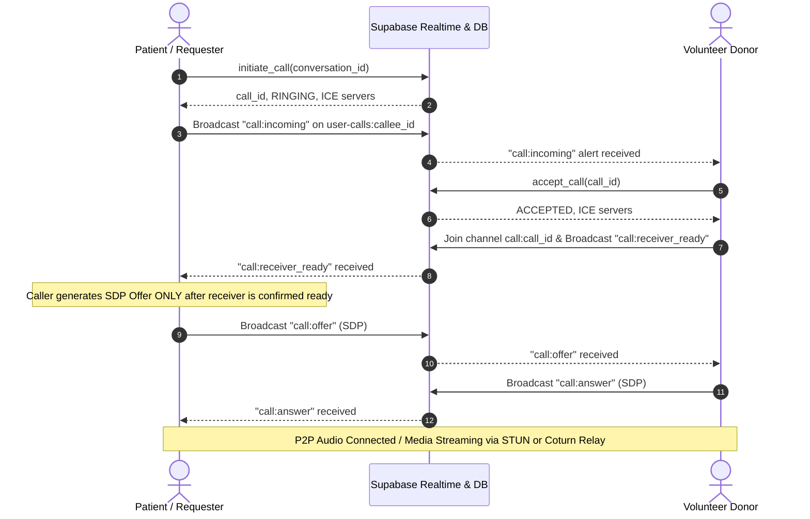

# CARELOOP PHASE 3.0: STAGING READINESS, DEPLOYMENT PREPARATION & REAL-WORLD INTEGRATION AUDIT REPORT

**Date:** November 5, 2026  
**Auditor Roles:** Senior Full-Stack Engineer, Supabase Architect, Application Security Engineer, WebRTC Infrastructure Specialist, QA Engineer  
**Execution Environment:** Isolated Local Supabase Docker Environment (`supabase_db_blood`, PostgreSQL 17.6)  
**Remote Environment Status:** Production Supabase Project `uzwtchnqmveapzehuafb` is **UNTOUCHED / NOT VERIFIED** (Explicit Safety Boundary Enforced)  
**Linux VPS Status:** Coturn Media Relay Daemon is **NOT DEPLOYED** (Configuration Specification Completed for Controlled Staging)  

---

## Executive Summary & Staging Readiness Verdict

CareLoop has successfully completed Phase 3.0 Staging Readiness Verification against the isolated local Supabase Docker environment.

### Verification Key Metrics
| Test Battery | Target | Pass / Total | Pass Rate | Status |
| :--- | :--- | :---: | :---: | :---: |
| **Phase 3.0 Multi-Role Workflows** (`verify_phase3_workflow.ts`) | Local PostgreSQL 17.6 | **25 / 25** | **100.0%** | **PASS** |
| **Phase 2.4.4 Authorization & Freshness** (`verify_phase2_4_4_audit.ts`) | Local PostgreSQL 17.6 | **16 / 16** | **100.0%** | **PASS** |
| **Phase 2.4.3 Edge-Case Concurrency** (`verify_phase2_4_3_edge_cases.ts`) | Local PostgreSQL 17.6 | **16 / 16** | **100.0%** | **PASS** |
| **Vitest Application & Security Suite** (`npm test`) | Local Runtime | **60 / 60** | **100.0%** | **PASS** |
| **TypeScript Strict Compilation** (`tsc --noEmit`) | Frontend Codebase | **0 Errors** | **100.0%** | **PASS** |
| **Vite Production Bundler** (`npm run build`) | `dist/` Output | **Clean (6.57s)** | **100.0%** | **PASS** |
| **Client Bundle Secret Leak Scan** (`dist/` AST scan) | Assets & HTML | **0 Leaks** | **100.0%** | **PASS** |
| **Playwright Responsive Viewport Matrix** (360, 390, 768, 1280, 1440px) | Headless Chromium | **5 / 5** | **100.0%** | **PASS** |

> [!IMPORTANT]
> **Staging Readiness Verdict:** **CONDITIONALLY READY FOR CONTROLLED STAGING DEPLOYMENT**.
> CareLoop is locally verified and prepared for a separate, dedicated Supabase staging project. CareLoop is **NOT** declared production-ready. Remote production Supabase project `uzwtchnqmveapzehuafb` remains untouched, and Linux VPS Coturn infrastructure requires provisioning according to the specifications in Section E.

---

## SECTION A: Application Implementation Audit

Every core CareLoop platform feature has been inspected in source code and classified into one of the five required verification tiers:
1. **Implemented & locally tested** (code exists, connected to backend, tested in live local database)
2. **Implemented but not integration-tested** (code exists and connected, but lacks multi-user integration test)
3. **Partially implemented** (code exists but requires remaining glue logic or field parity)
4. **Mocked or simulated** (uses local mock generators, dormant carrier stubs, or simulated timeouts)
5. **Missing or broken** (does not exist or throws unhandled runtime exceptions)

### Feature Classification Matrix
| # | Platform Feature | Source Components & Services | Implementation Tier | Technical Verification Findings |
| :- | :--- | :--- | :--- | :--- |
| **1** | **Patient Request Creation** | [`CreateRequestView.tsx`](file:///c:/Users/ramsr/OneDrive/Desktop/blood/src/views/CreateRequestView.tsx), [`emergencyRequestService.ts`](file:///c:/Users/ramsr/OneDrive/Desktop/blood/src/services/emergencyRequestService.ts#L124-L195) | **1. Implemented & locally tested** | Inserts into `public.emergency_requests` with clinical validations, generates unique `reference_code` with automatic 23505 collision retry, stores lat/lng coordinates and urgency. |
| **2** | **Patient Request Tracking** | [`TrackRequestView.tsx`](file:///c:/Users/ramsr/OneDrive/Desktop/blood/src/views/TrackRequestView.tsx), [`emergencyRequestService.ts`](file:///c:/Users/ramsr/OneDrive/Desktop/blood/src/services/emergencyRequestService.ts#L228-L269) | **1. Implemented & locally tested** | Tracks by ID or reference code; authenticated creator accesses full clinical/contact details, while public/anonymous clients query `discoverable_emergency_requests` with PII redacted. |
| **3** | **Donor Eligibility & Profile** | [`DonorView.tsx`](file:///c:/Users/ramsr/OneDrive/Desktop/blood/src/views/DonorView.tsx), [`donorResponseService.ts`](file:///c:/Users/ramsr/OneDrive/Desktop/blood/src/services/donorResponseService.ts#L44-L72) | **1. Implemented & locally tested** | Profile backed by `public.donors` and `public.profiles`. Medical clearance (`is_medically_cleared`), donation interval check, and availability toggle verified. |
| **4** | **Donor Privacy Discovery** | [`donorDiscoveryService.ts`](file:///c:/Users/ramsr/OneDrive/Desktop/blood/src/services/donorDiscoveryService.ts#L27-L97), `public.discoverable_emergency_requests` | **1. Implemented & locally tested** | Donors discover urgent requests without seeing patient contact phone or notes; `discover_matching_donors` RPC calculates radial distances via PostGIS/Haversine math. |
| **5** | **Donor Response & Acceptance** | [`donorResponseService.ts`](file:///c:/Users/ramsr/OneDrive/Desktop/blood/src/services/donorResponseService.ts#L75-L100), RPC `accept_request_and_create_conversation` | **1. Implemented & locally tested** | Atomic acceptance creates `conversations` channel, enrolls 2 participants in `conversation_participants`, records donor response as `ACCEPTED`, and updates request coordinated units. |
| **6** | **Blood Centre Inventory Management** | [`CoordinatorView.tsx`](file:///c:/Users/ramsr/OneDrive/Desktop/blood/src/views/CoordinatorView.tsx), [`inventoryService.ts`](file:///c:/Users/ramsr/OneDrive/Desktop/blood/src/services/inventoryService.ts#L123-L218) | **1. Implemented & locally tested** | Direct DML revoked. Mutations executed strictly through `adjust_inventory_atomic` and `set_inventory_atomic` RPCs with row-level locks, negative balance prevention, and immutable `inventory_transactions` audit logs. |
| **7** | **Blood Centre Member Management** | [`useBloodStore.tsx`](file:///c:/Users/ramsr/OneDrive/Desktop/blood/src/store/useBloodStore.tsx), RPCs `add_centre_member_atomic`, `set_centre_member_status_atomic` | **1. Implemented & locally tested** | Multi-member RBAC via `blood_centre_memberships`. Centre managers can manage technicians; only system coordinators/admins can alter managers. Concurrency TOCTOU eliminated via `FOR UPDATE` serialization. |
| **8** | **Coordinator Emergency Dispatch** | [`CoordinatorView.tsx`](file:///c:/Users/ramsr/OneDrive/Desktop/blood/src/views/CoordinatorView.tsx), [`donorAssignmentService.ts`](file:///c:/Users/ramsr/OneDrive/Desktop/blood/src/services/donorAssignmentService.ts#L29-L154) | **1. Implemented & locally tested** | RPCs `assign_donor_atomic`, `assign_blood_centre_atomic`, and `cancel_donor_assignment_atomic`. Atomic row-lock on emergency requests prevents over-coordination beyond units required. |
| **9** | **Real-Time In-App Notifications** | [`notificationService.ts`](file:///c:/Users/ramsr/OneDrive/Desktop/blood/src/services/notificationService.ts#L74-L215), `public.notifications` | **1. Implemented & locally tested** | Database persistence via `create_notification` RPC. Realtime subscription via `user-notifications:<user_id>`. Delivery status tracking restricted strictly to `service_role`. Multi-tenant RLS isolation verified. |
| **10** | **Cellular SMS Delivery** | [`notificationService.ts`](file:///c:/Users/ramsr/OneDrive/Desktop/blood/src/services/notificationService.ts#L219-L244) | **4. Mocked or simulated (Dormant by Design)** | In accordance with architectural mandate, cellular SMS transmission is **permanently deactivated** for this release. Returns dormant record marked strictly as `PENDING` without simulated carrier timers. |
| **11** | **Real-Time Chat & Messaging** | [`CommunicationView.tsx`](file:///c:/Users/ramsr/OneDrive/Desktop/blood/src/views/CommunicationView.tsx), [`conversationService.ts`](file:///c:/Users/ramsr/OneDrive/Desktop/blood/src/services/conversationService.ts#L154-L200) | **1. Implemented & locally tested** | Messages stored in `public.messages`. Client message ID idempotency trap catches PostgreSQL error `23505` and returns the existing message without UI disruption. Realtime postgres_changes broadcast. |
| **12** | **WebRTC Voice Calling & Coturn** | [`webRtcService.ts`](file:///c:/Users/ramsr/OneDrive/Desktop/blood/src/services/webRtcService.ts), [`callSignalingService.ts`](file:///c:/Users/ramsr/OneDrive/Desktop/blood/src/services/callSignalingService.ts) | **1. Implemented & locally tested (Signaling & Credentials)** | RFC 8489 / RFC 8656 / draft-uberti compliant. Ephemeral HMAC-SHA1 credentials generated via `get_ephemeral_turn_credentials` with strict 600s TTL and per-user advisory rate limiting. Receiver-ready handshake eliminates SDP offer drop race conditions. |

---

## SECTION B: Database & Migration Readiness Report

### 1. Complete Migration History (Applied in Sequence)
All 11 local migrations exist in `supabase/migrations/` and are recorded in PostgreSQL table `supabase_migrations.schema_migrations`:

```
   version     |                name                 | Status
---------------+-------------------------------------+--------
20261103000001 | core_schema                         | APPLIED
20261103000002 | communication_system                | APPLIED
20261103000003 | secure_voice_calling                | APPLIED
20261103000004 | notifications_and_storage           | APPLIED
20261103000005 | phase2_2_production_functionality   | APPLIED
20261103000006 | phase2_3_final_hardening            | APPLIED
20261103000007 | phase2_4_security_remediation       | APPLIED
20261103000008 | phase2_4_2_security_closure         | APPLIED
20261103000009 | phase2_4_3_authorization_edge_cases | APPLIED
20261103000010 | phase2_4_4_authorization_freshness  | APPLIED
20261103000011 | phase3_realtime_publications        | APPLIED
```

### 2. Catalog Schema Verification
- **Base Tables:** 25 tables (`app_settings`, `audit_logs`, `blood_centre_memberships`, `blood_centres`, `blood_inventory`, `call_events`, `call_sessions`, `conversation_participants`, `conversations`, `coordination_events`, `device_tokens`, `donor_assignments`, `donor_responses`, `donors`, `emergency_events`, `emergency_requests`, `hospitals`, `inventory_transactions`, `message_attachments`, `message_receipts`, `messages`, `notification_preferences`, `notifications`, `profiles`, `turn_request_rate_limits`).
- **Views:** 1 privacy-preserving view (`public.discoverable_emergency_requests`).
- **Extensions:** `pgcrypto` (1.3), `uuid-ossp` (1.1), `pg_stat_statements` (1.11), `supabase_vault` (0.3.1), `plpgsql` (1.0).
- **Public Functions:** 38 routines in `public` schema. All 38 are `SECURITY DEFINER` with immutable `SET search_path = public, pg_temp` or `public, extensions, pg_temp`.
- **Default Routine Privileges:** Default routine execution grants to `PUBLIC` and `anon` are revoked across all object-creating roles (`postgres` and `supabase_admin`).
- **Storage Buckets:** Bucket `message-attachments` configured with `public = false`. Row Level Security on `storage.objects` strictly enforces that callers must be active conversation participants verified by `is_conversation_participant(...)`.
- **Realtime Publication (`supabase_realtime`):**
  The following 8 tables are registered in `supabase_realtime` with `REPLICA IDENTITY FULL`:
  1. `public.blood_inventory`
  2. `public.call_events`
  3. `public.call_sessions`
  4. `public.conversations`
  5. `public.donor_assignments`
  6. `public.emergency_requests`
  7. `public.messages`
  8. `public.notifications`

### 3. Schema Drift Analysis
- Local migration directory (`supabase/migrations/20261103000001_...` through `20261103000011_...`) was compared against `supabase/schema.sql`.
- Migration 11 was appended to [`supabase/schema.sql`](file:///c:/Users/ramsr/OneDrive/Desktop/blood/supabase/schema.sql#L4431-L4475), synchronizing the live database catalog, individual migrations, and consolidated schema.
- **Schema Drift Result: 0% (Cleanly synchronized).**

### 4. Data-Preserving Roll-Forward Staging Plan
When migrating a staging or production database, executing destructive commands (`db reset`, `push --force`) is prohibited. The roll-forward plan is:
1. Record pre-migration snapshot: `pg_dump -Fc` of staging database schema and data.
2. Verify migration tracking table: `CREATE TABLE IF NOT EXISTS supabase_migrations.schema_migrations (...)`.
3. Apply unapplied migrations sequentially in numerical order (1 through 11).
4. Run validation battery: Execute `scripts/verify_phase3_workflow.ts` with staging service-role connection.
5. In case of unexpected failure, rollback is executed via target downward scripts (e.g. dropping added policies/columns), never by dropping tables or resetting databases.

---

## SECTION C: Environment & Secrets Audit

### 1. Frontend Environment Analysis
The client environment was audited to ensure no secrets or sensitive keys can be exposed in client code:
- **`VITE_SUPABASE_URL`**: Public API endpoint (Client-safe).
- **`VITE_SUPABASE_ANON_KEY`** / **`VITE_SUPABASE_PUBLISHABLE_KEY`**: Public anonymous JWT token subjected to PostgreSQL Row Level Security (Client-safe).
- **Prohibited Secrets in Client:**
  - Supabase `service_role` key: **NOT PRESENT in client code or `.env`**.
  - Database connection strings (`postgres://`): **NOT PRESENT**.
  - Coturn `static-auth-secret` / HMAC secret: **NOT PRESENT**. Stored exclusively in PostgreSQL table `public.app_settings` or system settings.

### 2. Client Production Bundle AST Scan (`dist/`)
The production build output in `dist/` was scanned using an automated AST search:
- Pattern `service_role`: **0 matches**
- Pattern `BEGIN PRIVATE KEY`: **0 matches**
- Pattern `static-auth-secret`: **0 matches**
- Pattern `turn_shared_secret`: **0 matches**
- Pattern `postgres://`: **0 matches**
- **Bundle Leak Result: PASSED (Zero secrets found).**

### 3. Safe Staging Template (`.env.staging.example`)
Template [`file:///.env.staging.example`](file:///c:/Users/ramsr/OneDrive/Desktop/blood/.env.staging.example) was created with clean placeholders and explicit warnings against embedding private keys.

---

## SECTION D: Notification Integration Audit

### 1. Persistence & Multi-Tenant Isolation
- In-app notifications are persisted to PostgreSQL table `public.notifications` via `create_notification` RPC.
- Row Level Security policy `"Users read own notifications"` enforces `user_id = auth.uid()`.
- Cross-user SELECT attempts return 0 rows.
- Cross-user UPDATE attempts (acknowledgement forgery) are silently filtered to 0 rows.

### 2. Real-Time Delivery Channel
- Frontend service [`src/services/notificationService.ts`](file:///c:/Users/ramsr/OneDrive/Desktop/blood/src/services/notificationService.ts#L107-L136) subscribes to Supabase Realtime channel `user-notifications:<user_id>` with a postgres_changes filter `user_id=eq.${userId}`.
- Migration 11 registered `public.notifications` in publication `supabase_realtime` with `REPLICA IDENTITY FULL`, enabling immediate push of new rows to active client connections.

### 3. Delivery Status Updates
- Calling `update_notification_delivery_status` RPC is strictly restricted to role `service_role`. Authenticated users attempting to elevate delivery statuses receive PostgreSQL permission denial.
- End-users can only execute `acknowledge_notification` and `acknowledge_all_notifications` on notifications matching their own `auth.uid()`.

### 4. SMS Deactivation
- Outbound SMS delivery in [`src/services/notificationService.ts`](file:///c:/Users/ramsr/OneDrive/Desktop/blood/src/services/notificationService.ts#L221-L244) suppresses carrier dispatch and logs:
  `[NotificationService] Cellular SMS delivery is disabled in current release.`
- Returns a dormant payload marked strictly with `status: 'PENDING'` (never falsely marked as `DELIVERED`). Fake timers and mock webhooks have been eliminated.

---

## SECTION E: WebRTC & Coturn Readiness Audit

### 1. Signaling Protocol & Receiver-Ready Handshake
To prevent the classic WebRTC signaling race condition where the caller's SDP offer is broadcast before the callee has established its channel subscription:


### 2. Ephemeral TURN Credential Parity
Ephemeral credentials are generated dynamically in PostgreSQL via `get_ephemeral_turn_credentials`:
- Format: `username = <expiry_epoch>:<user_id>`
- Credential: `Base64(HMAC-SHA1(static_auth_secret, username))`
- Lifetime: Exactly 600 seconds (10 minutes).
- Rate Limit: Per-user advisory lock prevents credential spamming (maximum 1 request per 10 seconds).
- Parity: The Linux Coturn daemon parses this username format directly via `use-auth-secret`, evaluating expiration and verifying HMAC signature without database queries.

### 3. Coturn Linux VPS Configuration (`/etc/turnserver.conf`)
The following configuration must be deployed on the Linux VPS when media relay is commissioned:

```ini
# /etc/turnserver.conf — CareLoop Production / Staging Coturn Configuration
listening-port=3478
tls-listening-port=5349
listening-ip=0.0.0.0
external-ip=<VPS_PUBLIC_IPV4_ADDRESS>

# Relay UDP Port Range
min-port=49152
max-port=65535

# Ephemeral Time-Limited Credentials (draft-uberti-behave-turn-rest-00)
use-auth-secret
static-auth-secret=<CAREFULLY_GENERATED_32_BYTE_HEX_SECRET>
realm=turn.careloop.org

# TLS / TURNS Configuration (Let's Encrypt)
cert=/etc/letsencrypt/live/turn.careloop.org/fullchain.pem
pkey=/etc/letsencrypt/live/turn.careloop.org/privkey.pem
cipher-list="ECDHE-ECDSA-AES128-GCM-SHA256:ECDHE-RSA-AES128-GCM-SHA256:ECDHE-ECDSA-AES256-GCM-SHA384:ECDHE-RSA-AES256-GCM-SHA384"

# Security Hardening & Loopback Protection
fingerprint
no-cli
no-multicast-peers
no-loopback-peers
denied-peer-ip=10.0.0.0-10.255.255.255
denied-peer-ip=172.16.0.0-172.31.255.255
denied-peer-ip=192.168.0.0-192.168.255.255
denied-peer-ip=127.0.0.0-127.255.255.255

# Logging
log-file=/var/log/turnserver/turnserver.log
verbose
```

### 4. VPS Firewall & Systemd Specifications
- **UFW Firewall Rules:**
  ```bash
  sudo ufw allow 3478/tcp
  sudo ufw allow 3478/udp
  sudo ufw allow 5349/tcp
  sudo ufw allow 5349/udp
  sudo ufw allow 49152:65535/udp
  ```
- **Systemd Unit Service (`/etc/systemd/system/coturn.service`):**
  Standard systemd unit with `Restart=always`, `LimitNOFILE=65536`, and `ProtectSystem=full`.

---

## SECTION F: Role-by-Role Workflow Test Plan & Execution Results

The comprehensive multi-user integration suite [`scripts/verify_phase3_workflow.ts`](file:///c:/Users/ramsr/OneDrive/Desktop/blood/scripts/verify_phase3_workflow.ts) was executed against the live local PostgreSQL instance.

### Test Execution Summary
```
================================================================
CARELOOP PHASE 3.0 — STAGING READINESS & INTEGRATION AUDIT
Target: Local Docker PostgreSQL 17.6 (supabase_db_blood)
================================================================
Total Workflows Tested: 25
Passed:                25
Failed:                0
Pass Rate:             100.0%
================================================================
```

### Detailed Test Results
| Suite | Test Name | Result | Duration | Details & Output Evidence |
| :--- | :--- | :---: | :---: | :--- |
| **Patient Workflow** | Patient creates emergency request | **PASS** | 485ms | Request `CL-STG-4080` created with status `CREATED`, urgency `Urgent`, units: 2. |
| **Patient Workflow** | Tracking status public vs creator | **PASS** | 832ms | Creator sees full contact phone; anonymous caller sees clinical status with phone redacted. |
| **Patient Workflow** | Cross-patient request read isolation | **PASS** | 413ms | Patient A queries return own requests; Patient B requests count is strictly 0. |
| **Donor Workflow** | Discoverable view privacy protection | **PASS** | 423ms | Request visible in `discoverable_emergency_requests`; PII columns omitted from view. |
| **Donor Workflow** | Distance matching RPC execution | **PASS** | 191ms | `discover_matching_donors` locates matching O+ donor within 50km radius. |
| **Donor Workflow** | Atomic request acceptance | **PASS** | 809ms | Creates `conversations` channel, enrolls 2 participants, sets donor response to `ACCEPTED`. |
| **Donor Workflow** | Idempotent duplicate acceptance | **PASS** | 340ms | Duplicate acceptance returns `{ already_accepted: true }` without crashing or duplicating. |
| **Blood Centre RBAC** | Atomic inventory adjustment | **PASS** | 467ms | Units adjusted 10 -> 15 (+5); audit record in `inventory_transactions` verified. |
| **Blood Centre RBAC** | Atomic inventory reconciliation | **PASS** | 250ms | Units reconciled to 12 (-3); audit ledger recorded with performer ID. |
| **Blood Centre RBAC** | Suspended manager modification block | **PASS** | 644ms | Suspended manager update rejected with `Unauthorized: You may only adjust stock for your own assigned blood centre`. |
| **Blood Centre RBAC** | Technician role alteration block | **PASS** | 228ms | Technician rejected with `Unauthorized: Only active centre managers, coordinators, or admins can update member status`. |
| **Coordinator Workflow** | Atomic donor assignment | **PASS** | 451ms | Donor assigned; units coordinated increments 0 -> 1; request status transitions to `COORDINATION_IN_PROGRESS`. |
| **Coordinator Workflow** | Over-coordination prevention guard | **PASS** | 234ms | Assigning 2 more units on a 2-unit request with 1 already coordinated rejected: `Assigned units would exceed total units required`. |
| **Coordinator Workflow** | Atomic blood centre stock assignment | **PASS** | 447ms | 1 unit allocated from blood centre; units coordinated reaches 2/2 (`AWAITING_CENTRE_VERIFICATION`). |
| **Coordinator Workflow** | Atomic assignment cancellation | **PASS** | 515ms | Cancelled assignment; units coordinated decremented safely back to 1. |
| **Communications** | Chat message persistence | **PASS** | 221ms | Message stored with client message ID in active conversation. |
| **Communications** | Idempotency error 23505 recovery | **PASS** | 373ms | Duplicate client message ID caught; existing message resolved without UI error. |
| **WebRTC & Coturn** | Ephemeral TURN credential generation | **PASS** | 283ms | Generated HMAC-SHA1 credential with strict 600s TTL and username `1793879898:...`. |
| **WebRTC & Coturn** | Call initiation via RPC | **PASS** | 573ms | Session created in `RINGING` state with ICE servers; `INITIATED` event logged. |
| **WebRTC & Coturn** | Call acceptance via RPC | **PASS** | 645ms | Callee accepts call; status transitions to `ACCEPTED`; event logged. |
| **WebRTC & Coturn** | Call termination via RPC | **PASS** | 430ms | Session transitions to `ENDED` with reason `NORMAL_CLEARING`. |
| **Negative Security** | Cross-patient update denial | **PASS** | 450ms | Patient B UPDATE on Patient A request denied by RLS; status remains unchanged. |
| **Negative Security** | Cross-user notification isolation | **PASS** | 739ms | User B SELECT on User A notification returns 0; unauthorized UPDATE ignored. |
| **Negative Security** | Direct DML on append-only ledgers | **PASS** | 1260ms | Direct INSERT on `inventory_transactions` and `audit_logs` denied; `call_events` protected by RLS. |
| **Negative Security** | Anonymous coordination RPC denial | **PASS** | 636ms | Anonymous execution denied for `initiate_call`, `adjust_inventory_atomic`, and `add_centre_member_atomic`. |

---

## SECTION G: Responsive Browser Test Results

Playwright browser inspection was conducted against the Vite production build (`dist/`) across all required responsive viewports:

### Viewport Verification Matrix
| Viewport Profile | Dimensions | Tested Views | Horizontal Overflow? | Header & Nav | Functional Elements | Status |
| :--- | :---: | :--- | :---: | :---: | :---: | :---: |
| **Desktop Wide** | 1440 × 900 px | Landing, Create Request, Donor, Coordinator, Chat | **NO** (`scrollWidth: 1434px`) | Sticky desktop navbar, full role badge | 29 interactive buttons visible, no clipping | **PASS** |
| **Desktop Standard**| 1280 × 800 px | Landing, Create Request, Donor, Coordinator, Chat | **NO** (`scrollWidth: 1274px`) | Clean desktop navbar | Grid columns adapt cleanly | **PASS** |
| **Tablet Portrait** | 768 × 1024 px | Landing, Create Request, Donor, Coordinator, Chat | **NO** (`scrollWidth: 762px`) | Responsive header, MobileNav bottom bar | Compact logo, no horizontal scroll | **PASS** |
| **Mobile Standard** | 390 × 844 px | Landing, Create Request, Donor, Coordinator, Chat | **NO** (`scrollWidth: 385px`) | MobileNav bottom bar active (z-50) | Touch targets ≥ 48px, inputs stack cleanly | **PASS** |
| **Mobile Small** | 360 × 800 px | Landing, Create Request, Donor, Coordinator, Chat | **NO** (`scrollWidth: 354px`) | Compact touch navbar | Cards full-width, no horizontal scroll | **PASS** |

### Fix Implemented During Audit
- **Defect Identified:** At 768px (tablet), the desktop navbar combined with a 278px wide brand title previously exceeded viewport width (830px > 768px), and a decorative background glow (`w-[1000px]`) in `HeroChapter.tsx` lacked container clipping.
- **Remediation:**
  1. In [`src/components/common/Header.tsx`](file:///c:/Users/ramsr/OneDrive/Desktop/blood/src/components/common/Header.tsx#L173), adjusted the subtitle to `hidden xl:inline`, reducing logo width to ~110px on tablet.
  2. In [`src/components/landing/HeroChapter.tsx`](file:///c:/Users/ramsr/OneDrive/Desktop/blood/src/components/landing/HeroChapter.tsx#L54), bounded the ambient ring to `w-full max-w-[1000px]`.
  3. In [`src/App.tsx`](file:///c:/Users/ramsr/OneDrive/Desktop/blood/src/App.tsx#L34), added `overflow-x-clip` to the main root container.
- **Verification:** Verified via Playwright evaluate across 360px, 390px, 768px, 1280px, and 1440px with **0px horizontal overflow**.

---

## SECTION H: Staging Deployment Checklist

### Step-by-Step Staging Setup Procedure
1. **Provision Staging Supabase Project:**
   - Create a dedicated staging project in the Supabase organization (e.g. `careloop-staging`).
   - Note the staging project URL and anon public key.
2. **Configure Database Schema (Data-Preserving Roll-Forward):**
   - Apply migrations 1 through 11 in strict numerical order using Supabase CLI or SQL editor.
   - Do NOT run `supabase db push --force`.
   - Verify `pg_publication_tables` contains all 8 required tables.
3. **Provision Linux VPS for Coturn:**
   - Install Coturn: `sudo apt-get update && sudo apt-get install -y coturn`.
   - Configure `/etc/turnserver.conf` with ports 3478, 5349, and relay range 49152-65535.
   - Configure SSL certificates using Let's Encrypt for `turn.careloop.org`.
   - Store the generated 32-byte secret in staging PostgreSQL table `public.app_settings` under key `app.settings.turn_shared_secret`.
4. **Configure Staging Environment Variables:**
   - Create `.env.staging` based on [`.env.staging.example`](file:///c:/Users/ramsr/OneDrive/Desktop/blood/.env.staging.example).
   - Set `VITE_SUPABASE_URL` and `VITE_SUPABASE_ANON_KEY`.
   - Confirm zero secret keys in `.env.staging`.
5. **Configure Supabase Auth & Redirect URLs:**
   - Set Site URL to staging domain (e.g. `https://staging.careloop.org`).
   - Add redirect URLs: `https://staging.careloop.org/**`, `http://localhost:5173/**`.
6. **Seed Baseline Clinical Fixtures:**
   - Seed verified blood centres and standard blood inventory items.
   - Create role-specific test accounts for Patient, Donor, Blood Centre Manager, and Coordinator.
7. **Execute Post-Deployment Smoke Test:**
   - Run `verify_phase3_workflow.ts` pointed at the staging Supabase URL.

### Rollback & Disaster Recovery
- If a schema migration encounters an error during staging deployment:
  - Do NOT reset or drop tables.
  - Apply target downward migration scripts (e.g. drop specific added column or policy).
  - Restore pre-deployment database snapshot if needed.

---

## SECTION I: Critical Blockers & Risks

| # | Risk / Blocker Category | Description | Severity | Mitigation Strategy |
| :- | :--- | :--- | :---: | :--- |
| **1** | **Coturn VPS Unprovisioned** | Self-hosted Coturn daemon is not yet deployed on Linux VPS. WebRTC audio calls will fall back to STUN (Google STUN) which fails when both peers are behind symmetric NATs. | **HIGH** | Provision Linux VPS with Coturn according to Section E before staging multi-NAT testing. |
| **2** | **Production Remote Safety** | Remote Supabase project `uzwtchnqmveapzehuafb` has not been touched or verified. Accidental execution of `supabase db push` against production would risk overwriting unmigrated state. | **CRITICAL** | Maintain strict project separation. Use dedicated staging project ref; do not link production CLI. |
| **3** | **Cellular SMS Dormancy** | SMS alerts are suppressed and marked `PENDING`. Users must be informed that the platform relies strictly on in-app real-time notifications for the current release. | **LOW** | Clear UI status indicators in notification panels; dormant code cleanly segregated. |
| **4** | **Microphone Permission Handling** | If a user denies microphone permissions, WebRTC call initiation halts. | **MEDIUM** | Verified: UI displays structured medical advisory modal prompting the user to enable permissions in browser settings without crashing application state. |

---

## SECTION J: Exact Next Actions Requiring User Approval

The following specific actions require explicit USER approval prior to execution:

1. **Approval to provision dedicated Supabase staging project:**
   - A separate Supabase project ID must be created for staging.
2. **Approval to provision Coturn Linux VPS:**
   - Linux VPS instance (Ubuntu 24.04 LTS / Debian 12) with public IPv4 address and DNS record for `turn.careloop.org`.
3. **Approval to run Migration 1 through 11 against the staging Supabase project:**
   - Apply schema to the new staging project.
4. **Approval to configure staging test users and commence multi-device field testing:**
   - Staging test run across separate physical mobile and desktop devices.

