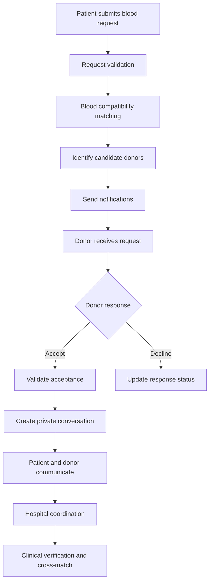
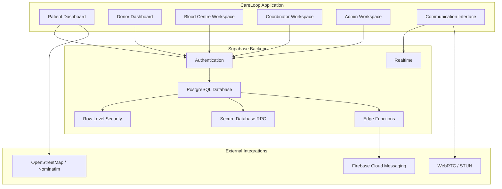

# 🩸 CareLoop — Emergency Blood Coordination Platform

<p align="center">
  
  
  
  
</p>

<p align="center">
  <b>Connecting patients, blood donors, hospitals, and emergency responders through one coordinated healthcare network.</b>
</p>

<p align="center">
  <a href="https://careloop-mauve.vercel.app/">Live Application</a> •
  <a href="#features">Features</a> •
  <a href="#architecture">Architecture</a> •
  <a href="#getting-started">Getting Started</a> •
  <a href="#security">Security</a>
</p>

---

## 🚨 About CareLoop

**CareLoop** is an emergency blood coordination platform designed to reduce the time and communication gaps between patients requiring blood, eligible donors, and healthcare facilities.

Traditional blood coordination often depends on manual phone calls, disconnected contacts, and time-consuming searches.

CareLoop brings these activities into one centralized platform.

Patients can submit emergency blood requests, the system can identify compatible candidate donors, donors can respond to requests, and accepted matches can communicate through a private coordination interface.

The platform also provides dedicated workspaces for blood centres, coordinators, and administrators.

> **Our mission:** Make emergency blood coordination faster, more accessible, transparent, and reliable.

<p align="center">
  <a href="https://careloop-mauve.vercel.app/">
    
  </a>
</p>

---

## ✨ Features

### 🏥 Patient Experience
- Submit emergency blood requests through a guided request workflow.
- Specify blood group, component, urgency, and hospital details.
- Discover nearby hospitals and healthcare facilities.
- Track submitted requests and matching activity.
- Connect with responding donors through private communication.
- Access a personalized patient dashboard.

### 🩸 Donor Network
- Dedicated donor registration and onboarding.
- Blood group and Rh-factor management.
- Blood component donation preferences.
- Location-aware donor matching.
- Availability and eligibility-related filtering.
- Receive relevant matching notifications.
- Accept or decline blood requests.
- Access private patient-donor communication after acceptance.

### ⚡ Intelligent Blood Matching

CareLoop uses blood-component compatibility rules rather than treating every blood donation as interchangeable.

Matching logic considers:
- ABO blood group.
- Rh compatibility.
- Blood component type.
- Donor availability.
- Location and proximity.
- Eligibility-related criteria.

Supported component categories include:

| Blood component | Matching consideration |
|---|---|
| Whole Blood | Exact group compatibility |
| Packed RBC | Red blood cell compatibility |
| Plasma / FFP | Plasma compatibility |
| Platelets | Component-specific compatibility |

**Important:** Automated matching identifies potential candidates. It does not replace medical assessment, laboratory testing, or hospital cross-matching. Final transfusion decisions belong to qualified healthcare professionals.

### 💬 Private Communication
- Patient-donor conversations.
- Request-linked communication.
- Persistent conversation history.
- Supabase-backed message storage.
- Realtime communication updates.
- Voice communication using WebRTC and realtime signaling where network conditions permit.

### 🔔 Notification System
- Firebase Cloud Messaging integration.
- Web push notifications.
- Device token registration.
- Event-driven notification dispatch.
- Relevant donor activity notifications.
- Privacy-conscious notification payloads.

### 🏨 Hospital & Blood Centre Network
- Hospital registration workflow.
- Blood centre management.
- Location-aware healthcare facility discovery.
- OpenStreetMap-based geographical discovery.
- Facility-specific operational information.

### 🛡️ Role-Based Workspaces

CareLoop supports five application roles:

| Role | Responsibilities |
|---|---|
| Patient | Submit and track blood requests |
| Donor | Manage donor information and respond to requests |
| Blood Centre | Manage blood centre operations |
| Coordinator | Coordinate emergency activities |
| Administrator | Manage users, verification, and platform operations |

Each workspace is protected by role-based access controls.

---

## 🔄 How CareLoop Works



### Core workflow

1. A patient submits an emergency blood request.
2. CareLoop processes the request and evaluates candidate donors.
3. Matching donors receive relevant notifications.
4. A donor accepts or declines the request.
5. Accepted requests pass through server-side validation.
6. The system establishes a private patient-donor conversation.
7. Both participants coordinate the next steps.
8. The hospital performs the necessary clinical verification.

---

## 🧰 Technology Stack

| Technology | Purpose |
|---|---|
| React | Frontend application |
| TypeScript | Type-safe application development |
| Vite | Development and production build tooling |
| Supabase | Backend infrastructure |
| PostgreSQL | Relational database |
| Supabase Auth | Authentication and session management |
| Supabase Realtime | Realtime updates and signaling |
| Supabase Edge Functions | Server-side workflows |
| Row Level Security | Database access protection |
| Firebase Cloud Messaging | Web push notifications |
| WebRTC | Peer-to-peer voice communication |
| OpenStreetMap / Nominatim | Location and facility discovery |
| Vercel | Application deployment |
| Progressive Web App | Installable web experience |

---

## 🏗️ Architecture



### Backend responsibilities

- Authentication and role management.
- Emergency request management.
- Donor profile and availability management.
- Blood compatibility matching.
- Request acceptance and assignment.
- Private conversation and message storage.
- Notification dispatch.
- Hospital and blood centre management.
- Administrative verification.

---

## 🔐 Security

Security is a core part of CareLoop because the platform handles sensitive healthcare coordination information.

Implemented security mechanisms include:

- Supabase Row Level Security (RLS).
- Role-protected application routes.
- Authenticated user sessions.
- Participant-restricted conversations.
- Private message access policies.
- Server-side request acceptance validation.
- Anti-self-matching checks.
- Transactional request acceptance and capacity locking.
- Restricted access to emergency request records.
- Notification payloads designed to avoid exposing patient-identifying information.

**Security principle:** Users should only access information and operations authorized for their account and role.

---

## 📱 Progressive Web Application

CareLoop is designed to support desktop and mobile experiences.

PWA capabilities include:

- Installable application experience.
- Web application manifest.
- Service worker integration.
- Responsive layouts.
- Mobile-friendly navigation.
- Push notification integration.
- Cached application assets.

Live application:

**https://careloop-mauve.vercel.app/**

---

## 🚀 Getting Started

### Prerequisites

- Node.js (LTS recommended).
- npm.
- Git.
- A Supabase project.
- Firebase project if push notifications are required.

### 1. Clone the repository

```bash
git clone https://github.com/ramganesh1201/BloodReach.git

cd BloodReach
```

### 2. Install dependencies

```bash
npm install
```

### 3. Configure environment variables

Create a `.env.local` file in the project root.

```env
VITE_SUPABASE_URL=your_supabase_project_url
VITE_SUPABASE_ANON_KEY=your_supabase_anon_key

VITE_FIREBASE_API_KEY=your_firebase_api_key
VITE_FIREBASE_PROJECT_ID=your_firebase_project_id
VITE_FIREBASE_VAPID_KEY=your_firebase_vapid_key
```

Configure additional server-side secrets separately in the appropriate deployment environment.

Never commit:
- Supabase service role keys.
- Firebase service account private keys.
- Database passwords.
- Private API credentials.

### 4. Start the development server

```bash
npm run dev
```

### 5. Create a production build

```bash
npm run build
```

### 6. Run tests

```bash
npm test
```

Check the project's `package.json` for the exact available scripts.

---

## 🗄️ Database & Backend Setup

CareLoop uses Supabase as its backend infrastructure.

The database supports the following major functional areas:

| Area | Purpose |
|---|---|
| Profiles | User accounts and roles |
| Donors | Donor information and preferences |
| Emergency Requests | Blood request lifecycle |
| Hospitals | Healthcare facility records |
| Blood Centres | Blood centre information |
| Donor Responses | Donor request responses |
| Assignments | Accepted donor-request relationships |
| Conversations | Private communication sessions |
| Messages | Persistent chat messages |
| Notifications | Notification records |
| Device Tokens | Push notification registration |
| Call Records | Voice communication coordination |

Database migrations are maintained in the repository's Supabase migration directory.

Apply and verify migrations using the project's configured Supabase CLI workflow before deploying database-dependent changes.

---

## 🔔 Integration Status

CareLoop integrates multiple services. Their operational requirements differ.

| Integration | Implementation | Operational consideration |
|---|---|---|
| Supabase Auth | Implemented | Project configuration required |
| PostgreSQL / RLS | Implemented | Migrations and policies must remain synchronized |
| Realtime Chat | Implemented | Authenticated participant access |
| Firebase Push | Integrated | Real-device delivery must be verified |
| WebRTC Calling | Integrated | Connectivity depends on network and NAT conditions |
| SMS Notifications | Integration in progress | Requires a compatible SMS provider and Indian DLT compliance |
| Hospital Discovery | Integrated | Depends on external geographical data availability |
| PWA | Implemented | Browser and device capabilities vary |

**Transparency matters:** A successful notification API response does not prove that a notification reached a physical device. Likewise, successful WebRTC signaling does not guarantee connectivity across every mobile network.

CareLoop is designed to use free and open-source technologies wherever practical. External providers, infrastructure limits, and network requirements may introduce costs.

---

## 🌐 Deployment

The production application is hosted on Vercel.

**Production URL:** https://careloop-mauve.vercel.app/

Deployment architecture:

```text
GitHub Repository
       |
       v
   Vercel Build
       |
       v
 Production Web App
       |
       v
 Supabase Backend
       |
       +---- PostgreSQL
       |
       +---- Authentication
       |
       +---- Realtime
       |
       +---- Edge Functions
       |
       +---- Firebase Notifications
```

Recommended deployment checks:

- Verify environment variables.
- Apply pending database migrations.
- Verify RLS policies.
- Deploy updated Edge Functions.
- Validate authentication and role permissions.
- Test request creation and donor matching.
- Test donor acceptance and conversation creation.
- Verify push notifications on real devices.
- Test mobile responsiveness.
- Verify production build and application health.

---

## 🎯 Project Objectives

CareLoop aims to:

1. Reduce delays in emergency blood coordination.
2. Improve connections between patients and potential donors.
3. Provide structured donor discovery and matching.
4. Improve communication after donor acceptance.
5. Connect healthcare facilities through a shared coordination platform.
6. Provide transparent administrative oversight.
7. Make emergency blood coordination more accessible through mobile and web technology.

---

## 🛣️ Future Development

Potential areas for continued development:

- Expanded hospital and blood centre network.
- Improved real-world notification delivery.
- Reliable cross-network voice calling.
- Feature-phone SMS response workflows.
- Native Android application distribution.
- Advanced operational analytics.
- Additional emergency coordination workflows.
- Improved geographical coverage and donor discovery.

---

## 🤝 Contributing

Contributions, suggestions, and improvements are welcome.

1. Fork the repository.
2. Create a feature branch.
3. Make your changes.
4. Run the available tests.
5. Submit a pull request with a clear description.

Please avoid committing secrets, patient information, or private production data.

---

## ⚠️ Medical Disclaimer

CareLoop is a technology platform for blood donation coordination. It is not a blood bank, medical diagnostic system, or substitute for professional healthcare services.

Donor matching is preliminary and does not establish medical eligibility or guarantee blood availability.

All donations and transfusions must follow applicable medical guidelines, laboratory testing, blood bank procedures, and qualified healthcare professional decisions.

---

## 📄 License

Add the project's chosen open-source license here before publishing or accepting external contributions.

---

<p align="center">
  
</p>

<h3 align="center">Every Drop Matters. Every Connection Counts.</h3>

<p align="center">
  <b>CareLoop — Connecting Lives Through Blood Donation.</b>
</p>

<p align="center">
  <a href="https://careloop-mauve.vercel.app/">Visit CareLoop</a> ·
  <a href="https://github.com/ramganesh1201/BloodReach">GitHub Repository</a>
</p>