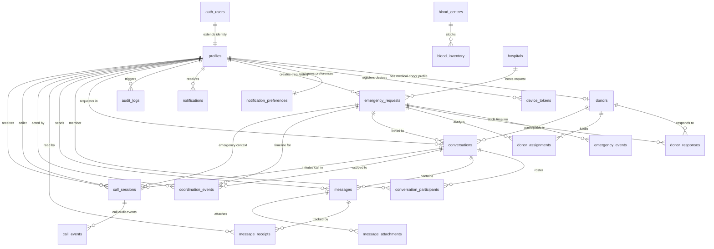

# CareLoop — Complete Database Architecture Audit & Migration Readiness Analysis

**Document Version:** 1.0.0  
**Audit Date:** November 3, 2026  
**Auditor:** Senior PostgreSQL Database Architect, Supabase Security Engineer & Full-Stack Application Auditor  
**Project Workspace:** `C:\Users\ramsr\OneDrive\Desktop\blood`  
**Supabase Project Reference:** `uzwtchnqmveapzehuafb` (BloodReach)  
**Database Engine:** PostgreSQL 17.6.1 (Supabase Hosted)  
**GoTrue Version:** 2.197.0  
**PostgREST Version:** 14.5  
**Mode:** Analysis-Only (No database or application modifications executed)

---

## 1. Executive Summary

### 1.1 Remote Database Status
A deep inspection of the remote Supabase project `uzwtchnqmveapzehuafb` confirms that **the remote `public` schema currently contains zero ordinary tables, zero custom views, zero custom functions, and zero applied migrations**. The remote database is effectively an untouched vanilla PostgreSQL instance provisioned with default Supabase system schemas (`auth`, `storage`, `realtime`, `vault`, `extensions`).

### 1.2 The Core Architectural Discrepancy
While the CareLoop frontend TypeScript code is mature, builds cleanly (`npm run build` passes with zero errors), passes type-checking (`tsc --noEmit`), and possesses comprehensive unit test coverage (12/12 passing tests for WebRTC voice calling), **the entire running application currently executes on in-memory mock seed data and browser `localStorage`**.

In `src/store/useBloodStore.tsx`:
- Emergency requests, donors, blood centres, inventory, conversations, chat messages, and coordination events are initialized from static TypeScript fixtures (`INITIAL_REQUEST`, `INITIAL_DONORS`, `INITIAL_BLOOD_CENTRES`, `INITIAL_INVENTORY`, `INITIAL_CONVERSATIONS`, etc.).
- State mutations modify in-memory arrays and serialize to `localStorage`.
- Direct Supabase client calls are currently limited to `supabase.auth.*`, `supabase.channel(...)` for real-time signaling, and tentative `supabase.rpc(...)` calls for voice-calling state transitions (`initiate_call`, `accept_call`, etc.).
- There are **no active PostgREST table queries** (`supabase.from('emergency_requests').select(...)`) operating in the frontend components.

### 1.3 The Fatal Migration Chain Blocker
The codebase contains a massive file `supabase/schema.sql` (730 lines) defining base tables (`profiles`, `emergency_requests`, `emergency_events`, `blood_centres`, `blood_inventory`, `donors`, `donor_responses`, `donor_assignments`, `notifications`, `audit_logs`). 

However, `supabase db push` **only executes files located in `supabase/migrations/*.sql`**. In `supabase/migrations/`, only three files exist:
1. `20261103_communication_system.sql`
2. `20261103_real_voice_calling.sql`
3. `20261103_repair_voice_calling_architecture.sql`

The first migration file `20261103_communication_system.sql` immediately executes:
```sql
CREATE TABLE IF NOT EXISTS public.conversations (
    id UUID PRIMARY KEY DEFAULT uuid_generate_v4(),
    request_id UUID NOT NULL REFERENCES public.emergency_requests(id) ON DELETE CASCADE,
    donor_id UUID NOT NULL REFERENCES public.donors(id) ON DELETE CASCADE,
    requester_id UUID NOT NULL REFERENCES public.profiles(id) ON DELETE CASCADE,
    ...
);
```

**Because `public.emergency_requests`, `public.donors`, and `public.profiles` exist only in `supabase/schema.sql` and NOT in any migration file, executing `supabase db push` against the remote Supabase instance will instantly crash with a fatal error:**
```
ERROR: relation "public.emergency_requests" does not exist (SQLSTATE 42P01)
```

Furthermore, migration files 2 and 3 overlap heavily, re-declaring the same stored procedures and columns with different signatures.

### 1.4 Migration Readiness Verdict
> [!CAUTION]
> **VERDICT: NOT READY FOR `supabase db push`.**  
> Attempting to push migrations in the current workspace state will abort on migration 1. To achieve a successful production deployment, the database migration structure must be consolidated into a clean, idempotent, dependency-ordered sequence starting with a proper base migration before pushing to Supabase.

---

## 2. Current Application Architecture & Feature Classification

Every feature in the CareLoop workspace was analyzed by inspecting the TypeScript source code, components, services, and store. The features are classified into five standard categories:

| Feature / Domain | Classification | Implementation Status & Details |
|---|---|---|
| **Supabase Client Setup** | Implemented in code | Initialized in `src/services/supabaseClient.ts` with Vite environment variables (`VITE_SUPABASE_URL`, `VITE_SUPABASE_ANON_KEY`). Contains fallback mock client when variables are missing. |
| **User Authentication (Sign Up / Sign In)** | Partially implemented | `src/store/useBloodStore.tsx` invokes `supabase.auth.signInWithPassword` and `signUp`. If network or credentials fail, falls back to local persona authentication for demo roles (`patient`, `donor`, `blood_centre`, `coordinator`, `admin`). |
| **Role-Based Profiles (RBAC)** | Partially implemented | TypeScript `UserProfile` and `UserRole` defined in `src/types/index.ts`. Schema defined in `supabase/schema.sql`. Currently persisted in browser `localStorage`. No automated trigger linking `auth.users` to `public.profiles` is deployed. |
| **Emergency Request Creation** | Partially implemented | Rich UI in `src/views/CreateRequestView.tsx` with urgent blood group selection, hospital coordinates, units required, and contact person. Saves to React store (`useBloodStore.tsx`). SQL table `emergency_requests` defined in `schema.sql` but not migrated. |
| **Haversine Distance & Donor Matching** | Implemented in code | Full geospatial matching engine implemented in `src/services/matchingEngine.ts`. Matches ABO/Rh compatibility, distance radius (default 15 km), donation eligibility intervals, and availability. Operates in-memory against local donor list. |
| **Shortage & Crisis Escalation Engine** | Implemented in code | `src/services/shortageEngine.ts` and `src/services/escalationEngine.ts` evaluate stock levels vs active emergency demand and increment escalation levels (1 to 4). Operates in-memory. |
| **Healthcare Facilities & Blood Centres** | Partially implemented | Directory of licensed facilities in Andhra Pradesh hardcoded in `src/data/healthcareFacilities/andhraPradesh.ts`. UI in `src/views/BloodCentreView.tsx` allows inventory management. SQL tables `blood_centres` and `blood_inventory` drafted in `schema.sql`. |
| **Donor Response & Acceptance** | Partially implemented | Donor UI in `src/views/DonorView.tsx` allows accepting/declining requests. Atomic procedure `accept_request_and_create_conversation` drafted in SQL, but currently updates local store state. |
| **Atomic Donor Assignment** | Partially implemented | Procedure `assign_donor_atomic` drafted in `supabase/schema.sql` with row-level locking (`FOR UPDATE`) to prevent over-allocation. Currently simulated in-memory in `useBloodStore.tsx`. |
| **Private Requester-Donor Chat** | Partially implemented | `src/views/CommunicationView.tsx` provides full messaging UI, typing indicators, and message timestamps. Stored in local store. SQL tables `conversations`, `conversation_participants`, `messages`, `message_receipts` drafted in migrations. |
| **File & Image Attachments** | Referenced but not implemented | UI contains attachment buttons and data model supports `MessageAttachment`. Table `message_attachments` defined in SQL. Supabase Storage bucket `message-attachments` and file upload client handlers are **not yet implemented**. |
| **Read Receipts & Delivery Tracking** | Partially implemented | UI indicates sent/delivered/read checkmarks. Table `message_receipts` defined in SQL. Currently updated locally in React store. |
| **Structured Coordination Timeline** | Implemented in code | `src/views/CommunicationView.tsx` and `src/components/communication/CoordinationTimeline.tsx` support 9 structured operational events (`CONFIRMED_AVAILABILITY`, `ON_THE_WAY`, `REACHED_HOSPITAL`, etc.). Stored in local store. Table `coordination_events` defined in SQL. |
| **WebRTC Audio Calling Engine** | Implemented in code | `src/services/webRtcService.ts` provides complete RTCPeerConnection lifecycle, SDP offer/answer handling, early ICE candidate queuing, audio track attachment, and clean teardown. Verified by 12 passing unit tests in Vitest. |
| **Private Realtime Signaling** | Implemented in code | `src/services/callSignalingService.ts` uses private Supabase Realtime broadcast channels with callee-ready handshakes, receiver-specific incoming channels (`user:<id>`), and call-room channels (`call:<id>`). |
| **Global Calling Interface** | Implemented in code | `src/components/communication/GlobalCallManager.tsx` mounts at root `src/App.tsx`, providing `VoiceCallModal` and `IncomingCallOverlay` across all routes without unmounting or duplicate instances. |
| **Dynamic TURN / Relay Server** | Requires external infrastructure | STUN configured to Google public STUN (`stun:stun.l.google.com:19302`). TURN requires Coturn or Metered.ca service credentials configured via Supabase Edge Function or backend secret. |
| **Push Notifications & Background Ringing**| Requires external infrastructure | In-app notification banner works via `src/services/notificationService.ts`. Background mobile/desktop push when browser is closed requires Web Push / Firebase Cloud Messaging (FCM) and VAPID key setup. |
| **Coordinator & Admin Governance** | Partially implemented | `src/views/CoordinatorView.tsx` displays active cases, escalation alerts, manual assignments, and audit trails. Reads and writes to local store. Table `audit_logs` defined in `schema.sql`. |
| **Offline Cache & Network Recovery** | Partially implemented | Offline queueing of chat messages in React store with `client_message_id`. LocalStorage caching of current profile and active requests. WebRTC auto-reconnects on network disruption. |

---

## 3. Database Dependency & Migration Audit

### 3.1 Inventory of Existing SQL Files

The project contains four SQL files:

```
supabase/
├── schema.sql                                                  (730 lines - Base Schema + Communication Draft)
└── migrations/
    ├── 20261103_communication_system.sql                       (375 lines - Communication Tables & Acceptance RPC)
    ├── 20261103_real_voice_calling.sql                         (546 lines - Voice Calling V1 RPCs)
    └── 20261103_repair_voice_calling_architecture.sql         (690 lines - Voice Calling V2 Hardened RPCs)
```

### 3.2 File-by-File Dependency Analysis

#### 1. `supabase/schema.sql`
- **Defines Tables (1-10):** `profiles`, `emergency_requests`, `emergency_events`, `blood_centres`, `blood_inventory`, `donors`, `donor_responses`, `donor_assignments`, `notifications`, `audit_logs`.
- **Defines Stored Procedures:** `assign_donor_atomic`, `get_user_role`.
- **Defines Tables (11-17 - Added during communication design):** `conversations`, `conversation_participants`, `messages`, `message_receipts`, `message_attachments`, `coordination_events`, `call_sessions`, `call_events`.
- **Defines Stored Procedures:** `accept_request_and_create_conversation`, `is_conversation_participant`.
- **Defines RLS Policies:** Complete RLS on all 17 tables.
- **CRITICAL FLAW:** This file is located in `supabase/schema.sql`. **Supabase CLI (`supabase db push`) completely ignores `supabase/schema.sql`**; it only applies files inside `supabase/migrations/`.

#### 2. `supabase/migrations/20261103_communication_system.sql`
- **Defines Tables:** `conversations`, `conversation_participants`, `messages`, `message_receipts`, `message_attachments`, `coordination_events`, `call_sessions`.
- **Foreign Key Dependencies:**
  - `conversations.request_id` -> `emergency_requests.id` (**DOES NOT EXIST IN MIGRATIONS**)
  - `conversations.donor_id` -> `donors.id` (**DOES NOT EXIST IN MIGRATIONS**)
  - `conversations.requester_id` -> `profiles.id` (**DOES NOT EXIST IN MIGRATIONS**)
  - `conversation_participants.user_id` -> `profiles.id` (**DOES NOT EXIST IN MIGRATIONS**)
  - `messages.sender_id` -> `profiles.id` (**DOES NOT EXIST IN MIGRATIONS**)
  - `message_receipts.user_id` -> `profiles.id` (**DOES NOT EXIST IN MIGRATIONS**)
  - `coordination_events.request_id` -> `emergency_requests.id` (**DOES NOT EXIST IN MIGRATIONS**)
  - `coordination_events.actor_id` -> `profiles.id` (**DOES NOT EXIST IN MIGRATIONS**)
  - `call_sessions.caller_id` -> `profiles.id` (**DOES NOT EXIST IN MIGRATIONS**)
  - `call_sessions.receiver_id` -> `profiles.id` (**DOES NOT EXIST IN MIGRATIONS**)
- **Defines Procedure:** `accept_request_and_create_conversation`.
- **CRITICAL FLAW:** Fails instantly on line 10 with SQLSTATE 42P01 (`relation "public.emergency_requests" does not exist`).

#### 3. `supabase/migrations/20261103_real_voice_calling.sql`
- **Modifies Table:** `call_sessions` (adds `request_id`, `ringing_at`, `accepted_at`, `metadata`).
- **Defines Table:** `call_events`.
- **Defines Stored Procedures:** `issue_ice_credentials`, `initiate_call`, `accept_call`, `record_call_connected`, `reject_call`, `cancel_call`, `end_call`, `expire_call`.
- **CRITICAL FLAW:** Missing `SET search_path = public, pg_temp` on several functions; uses legacy columns (`answered_at`, `termination_reason`); superseded by migration 4.

#### 4. `supabase/migrations/20261103_repair_voice_calling_architecture.sql`
- **Modifies Table:** `call_sessions` (adds `connected_at`, `end_reason`).
- **Replaces Stored Procedures:** Fully re-declares and hardens all 8 voice-calling RPCs with explicit `search_path`, atomic validations, and Realtime publications.
- **Enables Realtime:** Adds `call_sessions` and `call_events` to `supabase_realtime` publication.
- **Defines Realtime RLS:** Adds authorization policies to `realtime.messages`.
- **CRITICAL FLAW:** Redundant with Migration 2. If applied sequentially on an empty database, Migration 2 creates procedures and columns only for Migration 3 to immediately alter and recreate them.

### 3.3 Summary of Migration Blockers

```
┌────────────────────────────────────────────────────────────────────────┐
│ Current Migration Chain                                               │
├────────────────────────────────────────────────────────────────────────┤
│ [supabase/schema.sql] ──IGNORED BY CLI──> (Never pushed to remote DB)   │
│                                                                        │
│ 1. 20261103_communication_system.sql                                   │
│    └── References: emergency_requests, donors, profiles ──> [CRASH]   │
│                                                                        │
│ 2. 20261103_real_voice_calling.sql                                     │
│    └── Unreached. Overlaps with 20261103_repair_voice_calling.sql     │
│                                                                        │
│ 3. 20261103_repair_voice_calling_architecture.sql                     │
│    └── Unreached.                                                      │
└────────────────────────────────────────────────────────────────────────┘
```

---

## 4. Complete Required Database Entity Inventory

A comprehensive review of the 18 candidate entities was conducted based on the operational requirements of CareLoop.

### 4.1 Entity Evaluation & Architectural Decision

| Candidate Entity | Decision | Architectural Justification |
|---|---|---|
| `profiles` | **REQUIRED** | Core user identity table directly linked to `auth.users(id)` via foreign key with `ON DELETE CASCADE`. Stores full name, role, contact info, city, and account status. |
| `donors` | **REQUIRED** | Specialized medical profile for blood donors linked 1:1 with `profiles.id`. Contains blood group, availability status, GPS coordinates, deferral dates, medical clearance, and donation counts. |
| `emergency_requests` | **REQUIRED** | Central coordination entity for blood requests. Contains patient/hospital info, blood group, component, units required/coordinated, urgency, escalation level, and status machine. |
| `donor_responses` | **REQUIRED** | Tracks individual donor responses (`NOTIFIED`, `ACCEPTED`, `DECLINED`) per emergency request. Essential for atomic acceptance and preventing multi-donor race conditions. |
| `hospitals` | **REQUIRED (Separate Table)** | Currently embedded as text fields in `emergency_requests`. Introducing a dedicated `hospitals` table provides verified facility addresses, emergency contact phone numbers, GPS coordinates, and administrative oversight, while keeping foreign key nullable on `emergency_requests` to support unlisted rural clinics. |
| `blood_centres` | **REQUIRED** | Directory of licensed regional blood banks and transfusion facilities. Contains license numbers, contact info, operating hours, and location. |
| `blood_inventory` | **REQUIRED** | Stock tracking table linked to `blood_centres(id)`. Unique on `(blood_centre_id, blood_group, component)` to prevent duplicate inventory records. |
| `donor_assignments` | **REQUIRED** | Records formal donor fulfillment allocations against requests with coordinator tracking and unit quotas. |
| `coordinators` | **NOT A SEPARATE TABLE** | Redundant. Coordinators are fully represented by `profiles` where `role = 'coordinator'`. An additional table adds foreign-key complexity without unique relational attributes. |
| `emergency_events` | **REQUIRED** | Immutable audit trail for request lifecycle transitions (`CREATED`, `MATCHING_RESPONDERS`, `DONOR_ASSIGNED`, `FULFILLED`). |
| `notifications` | **REQUIRED** | System notification log with delivery channel tracking (`IN_APP`, `SMS`, `PUSH`, `EMAIL`) and acknowledgement timestamps. |
| `device_tokens` | **REQUIRED (New)** | Necessary for remote Web Push and Firebase Cloud Messaging (FCM). Maps `user_id` to device push endpoint tokens with platform metadata (`web`, `android`, `ios`). |
| `notification_preferences` | **REQUIRED (New)** | User notification settings controlling opt-ins for push, SMS, emergency call alerts, and quiet hours. |
| `conversations` | **REQUIRED** | Private request-scoped communication channel between requester and accepted donor. Enforces `UNIQUE(request_id, donor_id)`. |
| `conversation_participants` | **REQUIRED** | Participant roster defining active membership and unread read markers (`last_read_at`) for RLS evaluation. |
| `messages` | **REQUIRED** | Individual chat messages with sender role, content, client-generated message ID for offline idempotency, and edit/soft-delete timestamps. |
| `message_receipts` | **REQUIRED** | Granular delivery (`delivered_at`) and read (`read_at`) receipts per user per message. |
| `message_attachments` | **REQUIRED** | Metadata for uploaded lab reports, prescription slips, and verification images linked to Supabase Storage. |
| `coordination_events` | **REQUIRED** | Structured milestone events (`ON_THE_WAY`, `REACHED_HOSPITAL`, `CONFIRMED_ARRIVAL`) rendered in the timeline. |
| `call_sessions` | **REQUIRED** | WebRTC voice calling session table tracking caller, receiver, call state, duration, timestamps (`connected_at`, `ended_at`), and termination reason. |
| `call_events` | **REQUIRED** | Granular audit trail for WebRTC state changes (`INITIATED`, `RINGING`, `CONNECTED`, `ENDED`, `TIMEOUT`). |
| `audit_logs` | **REQUIRED** | Admin governance log for tracking privileged actions, security changes, and system events. |

---

### 4.2 Comprehensive Table Specifications

#### Table 1: `public.profiles`
- **Purpose:** User account profiles extending `auth.users`.
- **Primary Key:** `id UUID` (References `auth.users(id)` ON DELETE CASCADE).
- **Columns:**
  - `id UUID PRIMARY KEY REFERENCES auth.users(id) ON DELETE CASCADE`
  - `email TEXT UNIQUE NOT NULL`
  - `full_name TEXT NOT NULL`
  - `phone TEXT`
  - `role TEXT NOT NULL CHECK (role IN ('patient', 'donor', 'blood_centre', 'coordinator', 'admin'))`
  - `city TEXT`
  - `district TEXT`
  - `status TEXT NOT NULL DEFAULT 'ACTIVE' CHECK (status IN ('ACTIVE', 'SUSPENDED'))`
  - `created_at TIMESTAMPTZ DEFAULT NOW()`
  - `updated_at TIMESTAMPTZ DEFAULT NOW()`
- **Indexes:**
  - `idx_profiles_role ON public.profiles(role)`
  - `idx_profiles_email ON public.profiles(email)`
- **RLS Policies:**
  - `SELECT`: `auth.uid() = id OR public.get_user_role() IN ('coordinator', 'admin')`
  - `INSERT`: `auth.uid() = id`
  - `UPDATE`: `auth.uid() = id OR public.get_user_role() = 'admin'`
  - `DELETE`: `public.get_user_role() = 'admin'`

#### Table 2: `public.hospitals`
- **Purpose:** Verified medical facilities, hospital networks, and transfusion centers.
- **Primary Key:** `id UUID PRIMARY KEY DEFAULT gen_random_uuid()`
- **Columns:**
  - `id UUID PRIMARY KEY DEFAULT gen_random_uuid()`
  - `name TEXT NOT NULL`
  - `license_number TEXT`
  - `address TEXT NOT NULL`
  - `city TEXT NOT NULL`
  - `district TEXT`
  - `state TEXT DEFAULT 'Andhra Pradesh'`
  - `postal_code TEXT`
  - `emergency_phone TEXT NOT NULL`
  - `lat NUMERIC(9,6) NOT NULL`
  - `lng NUMERIC(9,6) NOT NULL`
  - `is_verified BOOLEAN NOT NULL DEFAULT true`
  - `created_at TIMESTAMPTZ DEFAULT NOW()`
- **Indexes:**
  - `idx_hospitals_city ON public.hospitals(city)`
  - `idx_hospitals_geo ON public.hospitals(lat, lng)`
- **RLS Policies:**
  - `SELECT`: `true` (Publicly readable)
  - `INSERT / UPDATE / DELETE`: `public.get_user_role() IN ('coordinator', 'admin')`

#### Table 3: `public.blood_centres`
- **Purpose:** Licensed blood banks and storage facilities.
- **Primary Key:** `id UUID PRIMARY KEY DEFAULT gen_random_uuid()`
- **Columns:**
  - `id UUID PRIMARY KEY DEFAULT gen_random_uuid()`
  - `name TEXT NOT NULL`
  - `license_number TEXT`
  - `address TEXT NOT NULL`
  - `city TEXT NOT NULL`
  - `district TEXT`
  - `state TEXT DEFAULT 'Andhra Pradesh'`
  - `phone TEXT NOT NULL`
  - `email TEXT`
  - `verified BOOLEAN NOT NULL DEFAULT true`
  - `lat NUMERIC(9,6)`
  - `lng NUMERIC(9,6)`
  - `operating_hours TEXT DEFAULT '24/7 Emergency Service'`
  - `inventory_updated_at TIMESTAMPTZ DEFAULT NOW()`
  - `created_at TIMESTAMPTZ DEFAULT NOW()`
- **Indexes:**
  - `idx_blood_centres_city ON public.blood_centres(city)`
- **RLS Policies:**
  - `SELECT`: `true` (Publicly readable)
  - `INSERT / UPDATE / DELETE`: `public.get_user_role() IN ('blood_centre', 'coordinator', 'admin')`

#### Table 4: `public.blood_inventory`
- **Purpose:** Real-time stock levels of blood units per facility.
- **Primary Key:** `id UUID PRIMARY KEY DEFAULT gen_random_uuid()`
- **Columns:**
  - `id UUID PRIMARY KEY DEFAULT gen_random_uuid()`
  - `blood_centre_id UUID NOT NULL REFERENCES public.blood_centres(id) ON DELETE CASCADE`
  - `blood_group TEXT NOT NULL CHECK (blood_group IN ('A+', 'A-', 'B+', 'B-', 'AB+', 'AB-', 'O+', 'O-'))`
  - `component TEXT NOT NULL CHECK (component IN ('Packed RBC', 'Whole Blood', 'Platelets', 'Plasma'))`
  - `units INTEGER NOT NULL DEFAULT 0 CHECK (units >= 0)`
  - `updated_at TIMESTAMPTZ DEFAULT NOW()`
  - `UNIQUE(blood_centre_id, blood_group, component)`
- **Indexes:**
  - `idx_inventory_centre_lookup ON public.blood_inventory(blood_centre_id, blood_group, component)`
- **RLS Policies:**
  - `SELECT`: `true` (Publicly readable)
  - `ALL`: `public.get_user_role() IN ('blood_centre', 'admin')`

#### Table 5: `public.donors`
- **Purpose:** Registered blood donor profiles and eligibility metadata.
- **Primary Key:** `id UUID PRIMARY KEY DEFAULT gen_random_uuid()`
- **Columns:**
  - `id UUID PRIMARY KEY DEFAULT gen_random_uuid()`
  - `profile_id UUID UNIQUE REFERENCES public.profiles(id) ON DELETE CASCADE`
  - `full_name TEXT NOT NULL`
  - `phone TEXT UNIQUE NOT NULL`
  - `email TEXT`
  - `blood_group TEXT NOT NULL CHECK (blood_group IN ('A+', 'A-', 'B+', 'B-', 'AB+', 'AB-', 'O+', 'O-'))`
  - `city TEXT NOT NULL`
  - `district TEXT`
  - `lat NUMERIC(9,6)`
  - `lng NUMERIC(9,6)`
  - `is_available BOOLEAN NOT NULL DEFAULT true`
  - `weight_kg NUMERIC(4,1)`
  - `birth_date DATE`
  - `last_donated_at TIMESTAMPTZ`
  - `last_donated_component TEXT CHECK (last_donated_component IN ('Packed RBC', 'Whole Blood', 'Platelets', 'Plasma'))`
  - `deferral_until TIMESTAMPTZ`
  - `is_medically_cleared BOOLEAN DEFAULT true`
  - `total_donations INTEGER NOT NULL DEFAULT 0 CHECK (total_donations >= 0)`
  - `created_at TIMESTAMPTZ DEFAULT NOW()`
- **Indexes:**
  - `idx_donors_search ON public.donors(blood_group, is_available, city)`
  - `idx_donors_profile ON public.donors(profile_id)`
- **RLS Policies:**
  - `SELECT`: `is_available = true OR profile_id = auth.uid() OR public.get_user_role() IN ('coordinator', 'admin')`
  - `INSERT`: `profile_id = auth.uid()`
  - `UPDATE`: `profile_id = auth.uid() OR public.get_user_role() IN ('coordinator', 'admin')`
  - `DELETE`: `public.get_user_role() = 'admin'`

#### Table 6: `public.emergency_requests`
- **Purpose:** Emergency blood requests initiated by patients, hospitals, or coordinators.
- **Primary Key:** `id UUID PRIMARY KEY DEFAULT gen_random_uuid()`
- **Columns:**
  - `id UUID PRIMARY KEY DEFAULT gen_random_uuid()`
  - `reference_code TEXT UNIQUE NOT NULL`
  - `blood_group TEXT NOT NULL CHECK (blood_group IN ('A+', 'A-', 'B+', 'B-', 'AB+', 'AB-', 'O+', 'O-'))`
  - `component TEXT NOT NULL CHECK (component IN ('Packed RBC', 'Whole Blood', 'Platelets', 'Plasma'))`
  - `units_required INTEGER NOT NULL CHECK (units_required > 0)`
  - `units_coordinated INTEGER NOT NULL DEFAULT 0 CHECK (units_coordinated >= 0)`
  - `urgency TEXT NOT NULL CHECK (urgency IN ('Today', 'Urgent', 'Critical'))`
  - `hospital_id UUID REFERENCES public.hospitals(id) ON DELETE SET NULL`
  - `hospital_name TEXT NOT NULL`
  - `hospital_address TEXT NOT NULL`
  - `city TEXT NOT NULL`
  - `district TEXT`
  - `state TEXT DEFAULT 'Andhra Pradesh'`
  - `postal_code TEXT`
  - `lat NUMERIC(9,6)`
  - `lng NUMERIC(9,6)`
  - `contact_name TEXT NOT NULL`
  - `contact_phone TEXT NOT NULL`
  - `contact_method TEXT NOT NULL DEFAULT 'Phone' CHECK (contact_method IN ('Phone', 'SMS', 'WhatsApp'))`
  - `status TEXT NOT NULL DEFAULT 'CREATED' CHECK (status IN (
      'CREATED', 'VERIFYING', 'CHECKING_RESOURCES', 'SHORTAGE_IDENTIFIED',
      'MATCHING_RESPONDERS', 'AWAITING_RESPONSE', 'RESPONDER_FOUND',
      'COORDINATION_IN_PROGRESS', 'DONOR_ASSIGNED',
      'AWAITING_CENTRE_VERIFICATION', 'FULFILLED', 'CANCELLED', 'EXPIRED'
    ))`
  - `escalation_level INTEGER NOT NULL DEFAULT 1 CHECK (escalation_level BETWEEN 1 AND 4)`
  - `created_by UUID REFERENCES public.profiles(id) ON DELETE SET NULL`
  - `cancellation_reason TEXT`
  - `notes TEXT`
  - `created_at TIMESTAMPTZ DEFAULT NOW()`
  - `updated_at TIMESTAMPTZ DEFAULT NOW()`
  - `CONSTRAINT check_units_coordinated_max CHECK (units_coordinated <= units_required)`
- **Indexes:**
  - `idx_requests_status ON public.emergency_requests(status)`
  - `idx_requests_blood ON public.emergency_requests(blood_group, urgency)`
  - `idx_requests_ref ON public.emergency_requests(reference_code)`
  - `idx_requests_creator ON public.emergency_requests(created_by)`
- **RLS Policies:**
  - `SELECT`: `true` (Emergency requests are discoverable for life-saving coordination)
  - `INSERT`: `public.get_user_role() IN ('patient', 'coordinator', 'admin') OR auth.uid() IS NULL` (Supports guest submissions)
  - `UPDATE`: `created_by = auth.uid() OR public.get_user_role() IN ('coordinator', 'blood_centre', 'admin')`
  - `DELETE`: `public.get_user_role() = 'admin'`

#### Table 7: `public.emergency_events`
- **Purpose:** Immutable audit event log tracking request state changes and actions.
- **Primary Key:** `id UUID PRIMARY KEY DEFAULT gen_random_uuid()`
- **Columns:**
  - `id UUID PRIMARY KEY DEFAULT gen_random_uuid()`
  - `request_id UUID NOT NULL REFERENCES public.emergency_requests(id) ON DELETE CASCADE`
  - `event_type TEXT NOT NULL`
  - `description TEXT NOT NULL`
  - `actor_role TEXT NOT NULL`
  - `metadata JSONB DEFAULT '{}'::jsonb`
  - `created_at TIMESTAMPTZ DEFAULT NOW()`
- **Indexes:**
  - `idx_events_req_date ON public.emergency_events(request_id, created_at ASC)`
- **RLS Policies:**
  - `SELECT`: `true`
  - `INSERT`: `auth.role() = 'authenticated'`
  - `UPDATE / DELETE`: `false` (Immutable)

#### Table 8: `public.donor_responses`
- **Purpose:** Records response status of notified donors to specific requests.
- **Primary Key:** `id UUID PRIMARY KEY DEFAULT gen_random_uuid()`
- **Columns:**
  - `id UUID PRIMARY KEY DEFAULT gen_random_uuid()`
  - `request_id UUID NOT NULL REFERENCES public.emergency_requests(id) ON DELETE CASCADE`
  - `donor_id UUID NOT NULL REFERENCES public.donors(id) ON DELETE CASCADE`
  - `response_status TEXT NOT NULL CHECK (response_status IN ('NOTIFIED', 'ACCEPTED', 'DECLINED'))`
  - `response_channel TEXT NOT NULL DEFAULT 'WEB' CHECK (response_channel IN ('WEB', 'SMS'))`
  - `created_at TIMESTAMPTZ DEFAULT NOW()`
  - `UNIQUE(request_id, donor_id)`
- **Indexes:**
  - `idx_donor_responses_req ON public.donor_responses(request_id, response_status)`
  - `idx_donor_responses_donor ON public.donor_responses(donor_id)`
- **RLS Policies:**
  - `SELECT`: `donor_id IN (SELECT id FROM public.donors WHERE profile_id = auth.uid()) OR public.get_user_role() IN ('coordinator', 'admin')`
  - `INSERT`: `public.get_user_role() IN ('coordinator', 'admin') OR donor_id IN (SELECT id FROM public.donors WHERE profile_id = auth.uid())`
  - `UPDATE`: `donor_id IN (SELECT id FROM public.donors WHERE profile_id = auth.uid()) OR public.get_user_role() IN ('coordinator', 'admin')`

#### Table 9: `public.donor_assignments`
- **Purpose:** Formal coordination assignments of donors to fulfill blood units.
- **Primary Key:** `id UUID PRIMARY KEY DEFAULT gen_random_uuid()`
- **Columns:**
  - `id UUID PRIMARY KEY DEFAULT gen_random_uuid()`
  - `request_id UUID NOT NULL REFERENCES public.emergency_requests(id) ON DELETE CASCADE`
  - `donor_id UUID NOT NULL REFERENCES public.donors(id) ON DELETE CASCADE`
  - `units_assigned INTEGER NOT NULL DEFAULT 1 CHECK (units_assigned > 0)`
  - `status TEXT NOT NULL DEFAULT 'ASSIGNED' CHECK (status IN ('ASSIGNED', 'CONFIRMED', 'DONATED', 'CANCELLED'))`
  - `assigned_at TIMESTAMPTZ DEFAULT NOW()`
  - `coordinator_id UUID REFERENCES public.profiles(id) ON DELETE SET NULL`
  - `notes TEXT`
  - `UNIQUE(request_id, donor_id)`
- **Indexes:**
  - `idx_assignments_req ON public.donor_assignments(request_id, status)`
- **RLS Policies:**
  - `SELECT`: `donor_id IN (SELECT id FROM public.donors WHERE profile_id = auth.uid()) OR public.get_user_role() IN ('coordinator', 'blood_centre', 'admin')`
  - `ALL`: `public.get_user_role() IN ('coordinator', 'admin')`

#### Table 10: `public.notifications`
- **Purpose:** Multi-channel notifications delivered to users.
- **Primary Key:** `id UUID PRIMARY KEY DEFAULT gen_random_uuid()`
- **Columns:**
  - `id UUID PRIMARY KEY DEFAULT gen_random_uuid()`
  - `user_id UUID REFERENCES public.profiles(id) ON DELETE CASCADE`
  - `recipient_phone TEXT`
  - `recipient_email TEXT`
  - `channel TEXT NOT NULL CHECK (channel IN ('IN_APP', 'SMS', 'PUSH', 'EMAIL'))`
  - `title TEXT`
  - `content TEXT NOT NULL`
  - `status TEXT NOT NULL DEFAULT 'QUEUED' CHECK (status IN ('QUEUED', 'SENT', 'DELIVERED', 'FAILED', 'ACKNOWLEDGED'))`
  - `metadata JSONB DEFAULT '{}'::jsonb`
  - `created_at TIMESTAMPTZ DEFAULT NOW()`
  - `acknowledged_at TIMESTAMPTZ`
- **Indexes:**
  - `idx_notifications_user_stat ON public.notifications(user_id, status)`
- **RLS Policies:**
  - `SELECT`: `user_id = auth.uid() OR user_id IS NULL`
  - `UPDATE`: `user_id = auth.uid()`
  - `INSERT`: `public.get_user_role() IN ('coordinator', 'admin') OR auth.role() = 'authenticated'`

#### Table 11: `public.device_tokens`
- **Purpose:** Mobile and browser push notification tokens for Web Push / FCM.
- **Primary Key:** `id UUID PRIMARY KEY DEFAULT gen_random_uuid()`
- **Columns:**
  - `id UUID PRIMARY KEY DEFAULT gen_random_uuid()`
  - `user_id UUID NOT NULL REFERENCES public.profiles(id) ON DELETE CASCADE`
  - `token TEXT NOT NULL`
  - `platform TEXT NOT NULL CHECK (platform IN ('web', 'android', 'ios'))`
  - `user_agent TEXT`
  - `created_at TIMESTAMPTZ DEFAULT NOW()`
  - `updated_at TIMESTAMPTZ DEFAULT NOW()`
  - `UNIQUE(user_id, token)`
- **Indexes:**
  - `idx_device_tokens_user ON public.device_tokens(user_id)`
- **RLS Policies:**
  - `SELECT / INSERT / UPDATE / DELETE`: `user_id = auth.uid()`

#### Table 12: `public.notification_preferences`
- **Purpose:** User notification preferences and quiet hours.
- **Primary Key:** `user_id UUID PRIMARY KEY REFERENCES public.profiles(id) ON DELETE CASCADE`
- **Columns:**
  - `user_id UUID PRIMARY KEY REFERENCES public.profiles(id) ON DELETE CASCADE`
  - `enable_in_app BOOLEAN NOT NULL DEFAULT true`
  - `enable_push BOOLEAN NOT NULL DEFAULT true`
  - `enable_sms BOOLEAN NOT NULL DEFAULT true`
  - `enable_emergency_calls BOOLEAN NOT NULL DEFAULT true`
  - `quiet_hours_start TIME`
  - `quiet_hours_end TIME`
  - `updated_at TIMESTAMPTZ DEFAULT NOW()`
- **RLS Policies:**
  - `ALL`: `user_id = auth.uid()`

#### Table 13: `public.conversations`
- **Purpose:** Request-linked private coordination channels between requester and accepted donor.
- **Primary Key:** `id UUID PRIMARY KEY DEFAULT gen_random_uuid()`
- **Columns:**
  - `id UUID PRIMARY KEY DEFAULT gen_random_uuid()`
  - `request_id UUID NOT NULL REFERENCES public.emergency_requests(id) ON DELETE CASCADE`
  - `donor_id UUID NOT NULL REFERENCES public.donors(id) ON DELETE CASCADE`
  - `requester_id UUID NOT NULL REFERENCES public.profiles(id) ON DELETE CASCADE`
  - `status TEXT NOT NULL DEFAULT 'ACTIVE' CHECK (status IN ('PENDING_ACCEPTANCE', 'ACTIVE', 'RESTRICTED', 'CLOSED'))`
  - `closed_at TIMESTAMPTZ`
  - `closure_reason TEXT`
  - `created_at TIMESTAMPTZ DEFAULT NOW()`
  - `updated_at TIMESTAMPTZ DEFAULT NOW()`
  - `UNIQUE(request_id, donor_id)`
- **Indexes:**
  - `idx_conversations_req ON public.conversations(request_id)`
  - `idx_conversations_donor ON public.conversations(donor_id)`
  - `idx_conversations_requester ON public.conversations(requester_id)`
- **RLS Policies:**
  - `SELECT`: `requester_id = auth.uid() OR donor_id IN (SELECT id FROM public.donors WHERE profile_id = auth.uid()) OR public.get_user_role() IN ('coordinator', 'admin')`
  - `UPDATE`: `public.get_user_role() IN ('coordinator', 'admin')`

#### Table 14: `public.conversation_participants`
- **Purpose:** Membership roster for private conversations.
- **Primary Key:** `id UUID PRIMARY KEY DEFAULT gen_random_uuid()`
- **Columns:**
  - `id UUID PRIMARY KEY DEFAULT gen_random_uuid()`
  - `conversation_id UUID NOT NULL REFERENCES public.conversations(id) ON DELETE CASCADE`
  - `user_id UUID NOT NULL REFERENCES public.profiles(id) ON DELETE CASCADE`
  - `participant_role TEXT NOT NULL CHECK (participant_role IN ('requester', 'donor', 'coordinator'))`
  - `is_active BOOLEAN NOT NULL DEFAULT true`
  - `joined_at TIMESTAMPTZ DEFAULT NOW()`
  - `last_read_at TIMESTAMPTZ DEFAULT NOW()`
  - `UNIQUE(conversation_id, user_id)`
- **Indexes:**
  - `idx_conv_participants_lookup ON public.conversation_participants(user_id, conversation_id)`
- **RLS Policies:**
  - `SELECT`: `public.is_conversation_participant(conversation_id)`
  - `UPDATE`: `user_id = auth.uid()` (For updating `last_read_at`)

#### Table 15: `public.messages`
- **Purpose:** Chat messages exchanged in private conversations.
- **Primary Key:** `id UUID PRIMARY KEY DEFAULT gen_random_uuid()`
- **Columns:**
  - `id UUID PRIMARY KEY DEFAULT gen_random_uuid()`
  - `conversation_id UUID NOT NULL REFERENCES public.conversations(id) ON DELETE CASCADE`
  - `sender_id UUID NOT NULL REFERENCES public.profiles(id) ON DELETE CASCADE`
  - `sender_name TEXT NOT NULL`
  - `sender_role TEXT NOT NULL CHECK (sender_role IN ('patient', 'donor', 'coordinator', 'blood_centre', 'system'))`
  - `message_type TEXT NOT NULL DEFAULT 'TEXT' CHECK (message_type IN ('TEXT', 'IMAGE', 'DOCUMENT', 'COORDINATION_EVENT', 'SYSTEM'))`
  - `content TEXT NOT NULL`
  - `client_message_id TEXT`
  - `reply_to_message_id UUID REFERENCES public.messages(id) ON DELETE SET NULL`
  - `metadata JSONB DEFAULT '{}'::jsonb`
  - `is_edited BOOLEAN NOT NULL DEFAULT false`
  - `created_at TIMESTAMPTZ DEFAULT NOW()`
  - `edited_at TIMESTAMPTZ`
  - `deleted_at TIMESTAMPTZ`
- **Indexes:**
  - `idx_messages_conv_created ON public.messages(conversation_id, created_at ASC)`
  - `idx_messages_client_id ON public.messages(client_message_id)`
- **RLS Policies:**
  - `SELECT`: `public.is_conversation_participant(conversation_id)`
  - `INSERT`: `public.is_conversation_participant(conversation_id) AND sender_id = auth.uid()`
  - `UPDATE`: `sender_id = auth.uid()`

#### Table 16: `public.message_receipts`
- **Purpose:** Delivery and read tracking per recipient.
- **Primary Key:** `id UUID PRIMARY KEY DEFAULT gen_random_uuid()`
- **Columns:**
  - `id UUID PRIMARY KEY DEFAULT gen_random_uuid()`
  - `message_id UUID NOT NULL REFERENCES public.messages(id) ON DELETE CASCADE`
  - `user_id UUID NOT NULL REFERENCES public.profiles(id) ON DELETE CASCADE`
  - `delivered_at TIMESTAMPTZ DEFAULT NOW()`
  - `read_at TIMESTAMPTZ`
  - `UNIQUE(message_id, user_id)`
- **Indexes:**
  - `idx_receipts_lookup ON public.message_receipts(message_id, user_id)`
- **RLS Policies:**
  - `SELECT`: `EXISTS (SELECT 1 FROM public.messages m WHERE m.id = message_id AND public.is_conversation_participant(m.conversation_id))`
  - `ALL`: `user_id = auth.uid()`

#### Table 17: `public.message_attachments`
- **Purpose:** Medical verification documents and prescription uploads.
- **Primary Key:** `id UUID PRIMARY KEY DEFAULT gen_random_uuid()`
- **Columns:**
  - `id UUID PRIMARY KEY DEFAULT gen_random_uuid()`
  - `message_id UUID NOT NULL REFERENCES public.messages(id) ON DELETE CASCADE`
  - `storage_path TEXT NOT NULL`
  - `file_name TEXT NOT NULL`
  - `mime_type TEXT NOT NULL CHECK (mime_type IN ('image/jpeg', 'image/png', 'image/webp', 'application/pdf'))`
  - `file_size INTEGER NOT NULL CHECK (file_size > 0 AND file_size <= 10485760)`
  - `created_at TIMESTAMPTZ DEFAULT NOW()`
- **Indexes:**
  - `idx_attachments_msg ON public.message_attachments(message_id)`
- **RLS Policies:**
  - `SELECT`: `EXISTS (SELECT 1 FROM public.messages m WHERE m.id = message_id AND public.is_conversation_participant(m.conversation_id))`
  - `INSERT`: `EXISTS (SELECT 1 FROM public.messages m WHERE m.id = message_id AND m.sender_id = auth.uid())`

#### Table 18: `public.coordination_events`
- **Purpose:** Structured milestone events rendered in the coordination timeline.
- **Primary Key:** `id UUID PRIMARY KEY DEFAULT gen_random_uuid()`
- **Columns:**
  - `id UUID PRIMARY KEY DEFAULT gen_random_uuid()`
  - `request_id UUID NOT NULL REFERENCES public.emergency_requests(id) ON DELETE CASCADE`
  - `conversation_id UUID REFERENCES public.conversations(id) ON DELETE SET NULL`
  - `actor_id UUID NOT NULL REFERENCES public.profiles(id) ON DELETE CASCADE`
  - `actor_role TEXT NOT NULL`
  - `event_type TEXT NOT NULL CHECK (event_type IN (
      'CONFIRMED_AVAILABILITY', 'ON_THE_WAY', 'REACHED_HOSPITAL',
      'UNABLE_TO_PROCEED', 'WITHDRAWN', 'SHARED_HOSPITAL_DETAILS',
      'REQUESTED_UPDATE', 'CONFIRMED_ARRIVAL', 'COORDINATION_OUTCOME'
    ))`
  - `event_data JSONB DEFAULT '{}'::jsonb`
  - `created_at TIMESTAMPTZ DEFAULT NOW()`
- **Indexes:**
  - `idx_coord_events_conv ON public.coordination_events(conversation_id, created_at ASC)`
  - `idx_coord_events_req ON public.coordination_events(request_id, created_at ASC)`
- **RLS Policies:**
  - `SELECT`: `conversation_id IS NULL OR public.is_conversation_participant(conversation_id)`
  - `INSERT`: `actor_id = auth.uid() AND (conversation_id IS NULL OR public.is_conversation_participant(conversation_id))`

#### Table 19: `public.call_sessions`
- **Purpose:** WebRTC voice call session state machine.
- **Primary Key:** `id UUID PRIMARY KEY DEFAULT gen_random_uuid()`
- **Columns:**
  - `id UUID PRIMARY KEY DEFAULT gen_random_uuid()`
  - `conversation_id UUID NOT NULL REFERENCES public.conversations(id) ON DELETE CASCADE`
  - `request_id UUID REFERENCES public.emergency_requests(id) ON DELETE CASCADE`
  - `caller_id UUID NOT NULL REFERENCES public.profiles(id) ON DELETE CASCADE`
  - `receiver_id UUID NOT NULL REFERENCES public.profiles(id) ON DELETE CASCADE`
  - `call_type TEXT NOT NULL DEFAULT 'VOICE' CHECK (call_type IN ('VOICE', 'DIALER_FALLBACK'))`
  - `status TEXT NOT NULL DEFAULT 'INITIATING' CHECK (status IN (
      'INITIATING', 'RINGING', 'ACCEPTED', 'CONNECTED', 'ENDED', 'REJECTED', 'TIMEOUT', 'FAILED'
    ))`
  - `started_at TIMESTAMPTZ DEFAULT NOW()`
  - `ringing_at TIMESTAMPTZ`
  - `accepted_at TIMESTAMPTZ`
  - `connected_at TIMESTAMPTZ`
  - `ended_at TIMESTAMPTZ`
  - `duration_seconds INTEGER DEFAULT 0`
  - `end_reason TEXT`
  - `metadata JSONB DEFAULT '{}'::jsonb`
- **Indexes:**
  - `idx_call_sessions_caller_receiver ON public.call_sessions(caller_id, receiver_id, status)`
  - `idx_call_sessions_receiver_status ON public.call_sessions(receiver_id, status)`
  - `idx_call_sessions_started_at ON public.call_sessions(started_at DESC)`
- **RLS Policies:**
  - `SELECT`: `caller_id = auth.uid() OR receiver_id = auth.uid() OR public.get_user_role() IN ('coordinator', 'admin')`
  - `INSERT`: `caller_id = auth.uid() AND public.is_conversation_participant(conversation_id)`
  - `UPDATE`: `caller_id = auth.uid() OR receiver_id = auth.uid()`

#### Table 20: `public.call_events`
- **Purpose:** Audit trail of call state transitions and signaling events.
- **Primary Key:** `id UUID PRIMARY KEY DEFAULT gen_random_uuid()`
- **Columns:**
  - `id UUID PRIMARY KEY DEFAULT gen_random_uuid()`
  - `call_id UUID NOT NULL REFERENCES public.call_sessions(id) ON DELETE CASCADE`
  - `event_type TEXT NOT NULL CHECK (event_type IN (
      'INITIATED', 'RINGING', 'ACCEPTED', 'CONNECTED', 'MUTED', 'UNMUTED',
      'RECONNECTED', 'ENDED', 'REJECTED', 'TIMEOUT', 'FAILED'
    ))`
  - `actor_id UUID REFERENCES public.profiles(id) ON DELETE SET NULL`
  - `event_data JSONB DEFAULT '{}'::jsonb`
  - `created_at TIMESTAMPTZ DEFAULT NOW()`
- **Indexes:**
  - `idx_call_events_call_created ON public.call_events(call_id, created_at ASC)`
- **RLS Policies:**
  - `SELECT`: `EXISTS (SELECT 1 FROM public.call_sessions cs WHERE cs.id = call_id AND (cs.caller_id = auth.uid() OR cs.receiver_id = auth.uid() OR public.get_user_role() IN ('coordinator', 'admin')))`
  - `INSERT`: `EXISTS (SELECT 1 FROM public.call_sessions cs WHERE cs.id = call_id AND (cs.caller_id = auth.uid() OR cs.receiver_id = auth.uid() OR public.get_user_role() IN ('coordinator', 'admin')))`

#### Table 21: `public.audit_logs`
- **Purpose:** Immutable administrative and security audit logging.
- **Primary Key:** `id UUID PRIMARY KEY DEFAULT gen_random_uuid()`
- **Columns:**
  - `id UUID PRIMARY KEY DEFAULT gen_random_uuid()`
  - `user_id UUID REFERENCES public.profiles(id) ON DELETE SET NULL`
  - `action TEXT NOT NULL`
  - `target_table TEXT NOT NULL`
  - `target_id TEXT`
  - `details JSONB DEFAULT '{}'::jsonb`
  - `created_at TIMESTAMPTZ DEFAULT NOW()`
- **Indexes:**
  - `idx_audit_logs_user_date ON public.audit_logs(user_id, created_at DESC)`
- **RLS Policies:**
  - `SELECT`: `public.get_user_role() = 'admin'`
  - `INSERT`: `auth.role() = 'authenticated'`
  - `UPDATE / DELETE`: `false` (Immutable)

---

## 5. Entity-Relationship Architecture



---

## 6. Stored Procedures, Functions, Triggers & Index Inventory

### 6.1 Stored Procedures & Functions Inventory

| Function Name | Return Type | Language | Security | Explicit `search_path` | Purpose |
|---|---|---|---|---|---|
| `get_user_role()` | `TEXT` | `sql` | `SECURITY DEFINER` | **Needs: `public, pg_temp`** | Returns `role` from `profiles` for `auth.uid()`. Used extensively in RLS policies. |
| `is_conversation_participant(p_conv_id UUID)` | `BOOLEAN` | `sql` | `SECURITY DEFINER` | **Needs: `public, pg_temp`** | Returns `true` if `auth.uid()` is an active participant or coordinator/admin. |
| `assign_donor_atomic(p_request_id, p_donor_id, p_units, p_coordinator_id)` | `JSONB` | `plpgsql` | `SECURITY DEFINER` | **Needs: `public, pg_temp`** | Prevents race conditions during donor assignment using `SELECT ... FOR UPDATE`. |
| `accept_request_and_create_conversation(p_request_id, p_donor_id)` | `JSONB` | `plpgsql` | `SECURITY DEFINER` | **Needs: `public, pg_temp`** | Locks request, marks donor accepted, provisions conversation, joins participants, and logs system event atomically. |
| `issue_ice_credentials(p_call_id UUID)` | `JSONB` | `plpgsql` | `SECURITY DEFINER` | **Set: `public, pg_temp`** | Verifies participant authorization and returns STUN/TURN server URLs. |
| `initiate_call(p_conversation_id UUID, p_call_type TEXT)` | `JSONB` | `plpgsql` | `SECURITY DEFINER` | **Set: `public, pg_temp`** | Validates active conversation and confirmed donor acceptance, verifies no existing active call, inserts ringing session. |
| `accept_call(p_call_id UUID)` | `JSONB` | `plpgsql` | `SECURITY DEFINER` | **Set: `public, pg_temp`** | Callee authorization, transitions `RINGING` -> `ACCEPTED`, records `accepted_at`. |
| `record_call_connected(p_call_id UUID)` | `JSONB` | `plpgsql` | `SECURITY DEFINER` | **Set: `public, pg_temp`** | WebRTC connection verification, transitions `ACCEPTED` -> `CONNECTED`, records `connected_at`. |
| `reject_call(p_call_id UUID, p_reason TEXT)` | `JSONB` | `plpgsql` | `SECURITY DEFINER` | **Set: `public, pg_temp`** | Transitions `RINGING` -> `REJECTED`, sets `end_reason`. |
| `cancel_call(p_call_id UUID, p_reason TEXT)` | `JSONB` | `plpgsql` | `SECURITY DEFINER` | **Set: `public, pg_temp`** | Caller cancellation before callee answers, transitions to `ENDED`. |
| `end_call(p_call_id UUID, p_reason TEXT)` | `JSONB` | `plpgsql` | `SECURITY DEFINER` | **Set: `public, pg_temp`** | Participant termination, calculates `duration_seconds` from `connected_at`, sets `status = 'ENDED'`. |
| `expire_call(p_call_id UUID)` | `JSONB` | `plpgsql` | `SECURITY DEFINER` | **Set: `public, pg_temp`** | Times out unanswered calls older than 30 seconds (`status = 'TIMEOUT'`). |
| `handle_new_user()` | `TRIGGER` | `plpgsql` | `SECURITY DEFINER` | **Needs: `public, pg_temp`** | Auto-creates a default `profiles` row when a new user registers in `auth.users`. |

### 6.2 Security Audit of Database Functions
1. **Search Path Vulnerability:** Functions defined in `supabase/schema.sql` (`get_user_role`, `is_conversation_participant`, `assign_donor_atomic`, `accept_request_and_create_conversation`) omit explicit `SET search_path = public, pg_temp`. In PostgreSQL `SECURITY DEFINER` functions, this allows potential search path hijacking.  
   *Requirement: Every function must explicitly include `SET search_path = public, pg_temp`.*
2. **Execution Permissions:** PostgreSQL grants `EXECUTE` on new functions to `PUBLIC` by default.  
   *Requirement: Explicitly execute `REVOKE EXECUTE ON FUNCTION ... FROM PUBLIC;` and `GRANT EXECUTE ON FUNCTION ... TO authenticated;`.*

---

## 7. Row Level Security & Multi-Tenancy Review

### 7.1 Identity Spoofing Protection
- **Caller / Callee Spoofing:** In `call_sessions`, RLS enforces that `caller_id` must match `auth.uid()`, and the stored procedure `initiate_call` inspects `v_conv.requester_id` and `v_conv.donor_id` to strictly resolve the exact receiver.
- **Message Sender Spoofing:** In `messages`, RLS enforces `sender_id = auth.uid()` and validates that `auth.uid()` is an active participant in `conversation_participants`.
- **Donor Acceptance Forgery:** In `accept_request_and_create_conversation`, the function verifies that the caller owns the donor profile (`donor.profile_id = auth.uid()`) or has coordinator/admin privileges.
- **Coordination Event Forgery:** In `coordination_events`, RLS checks `actor_id = auth.uid()`.

### 7.2 Guest Emergency Request Submissions
CareLoop allows panic/guest emergency requests where the requester has not yet signed up (`created_by IS NULL`). The policy on `emergency_requests`:
```sql
CREATE POLICY "Authorized roles create requests" ON public.emergency_requests
    FOR INSERT WITH CHECK (
        public.get_user_role() IN ('patient', 'coordinator', 'admin')
        OR auth.uid() IS NULL
    );
```
This is safe because guests cannot modify existing records or view private communications. Once a coordinator triages the request, the coordinator can link the patient profile.

---

## 8. Realtime & Private Channel Security

### 8.1 Realtime Publication Configuration
To support instant incoming call alerts and chat updates across devices, the following tables must be published to Supabase Realtime:
```sql
ALTER PUBLICATION supabase_realtime ADD TABLE public.conversations;
ALTER PUBLICATION supabase_realtime ADD TABLE public.messages;
ALTER PUBLICATION supabase_realtime ADD TABLE public.call_sessions;
ALTER PUBLICATION supabase_realtime ADD TABLE public.call_events;
```

### 8.2 Private Broadcast Channels via `realtime.messages` RLS
WebRTC signaling (SDP offer/answer and ICE candidate exchange) uses Supabase Realtime Broadcast channels:
1. **Receiver Incoming Alerts:** Channel `user:<user_id>` — only the authenticated recipient can subscribe.
2. **Call Room Signaling:** Channel `call:<call_session_id>` — only authorized call participants (`caller_id`, `receiver_id`, or coordinator) can broadcast or receive.

The database must enforce this via RLS on `realtime.messages`:
```sql
CREATE POLICY "Call participants can listen to call rooms"
ON realtime.messages
FOR SELECT
TO authenticated
USING (
    (realtime.topic() LIKE 'call:%' AND EXISTS (
        SELECT 1 FROM public.call_sessions cs
        WHERE cs.id::text = substring(realtime.topic() from 6)
          AND (cs.caller_id = auth.uid() OR cs.receiver_id = auth.uid() OR public.get_user_role() IN ('coordinator', 'admin'))
    ))
    OR (realtime.topic() = 'user:' || auth.uid()::text)
);
```

---

## 9. Storage & Attachment Security

### 9.1 Storage Bucket Configuration
The application requires a private Supabase Storage bucket for prescription slips and medical verification attachments:
- **Bucket ID:** `message-attachments`
- **Public:** `false` (Strictly private)
- **Allowed MIME types:** `image/jpeg`, `image/png`, `image/webp`, `application/pdf`
- **File size limit:** 10 MB (`10485760` bytes)

### 9.2 Storage RLS Policies
Storage objects must be partitioned by conversation ID (`conversations/<conversation_id>/<message_id>/<file>`).
Access is controlled by checking participant membership:
```sql
-- Read Access
CREATE POLICY "Participants read attachments"
ON storage.objects
FOR SELECT
TO authenticated
USING (
    bucket_id = 'message-attachments'
    AND public.is_conversation_participant((storage.foldername(name))[2]::uuid)
);

-- Upload Access
CREATE POLICY "Participants upload attachments"
ON storage.objects
FOR INSERT
TO authenticated
WITH CHECK (
    bucket_id = 'message-attachments'
    AND public.is_conversation_participant((storage.foldername(name))[2]::uuid)
);
```

---

## 10. WebRTC Voice Calling Infrastructure Audit

### 10.1 Signaling Handshake & State Machine
The CareLoop calling architecture implements a deterministic 7-stage state machine:

```
[INITIATING] ──(initiate_call RPC)──> [RINGING]
                                         │
        ┌────────────────────────────────┴────────────────────────────────┐
        │ (callee rejects)                                                │ (callee accepts)
        ▼                                                                 ▼
   [REJECTED]                                                        [ACCEPTED]
                                                                          │
        ┌─────────────────────────────────────────────────────────────────┴──┐
        │ (WebRTC peer connection succeeds)                                  │ (timeout / network drop)
        ▼                                                                    ▼
  [CONNECTED]                                                             [FAILED]
        │
        │ (user hangs up / cancel)
        ▼
     [ENDED]
```

### 10.2 Race-Free SDP Negotiation Sequence
1. **Initiation:** Caller invokes `initiate_call(conversationId)`. Backend validates eligibility, returns `call_id`, and creates `call_sessions` row with status `RINGING`.
2. **Channel Subscription:** Caller joins `call:<call_id>`. Callee is alerted via `user:<callee_id>` and joins `call:<call_id>`.
3. **Callee Ready Handshake:** Callee emits `callee_ready` over `call:<call_id>`.
4. **Offer Generation:** Caller receives `callee_ready` and only then creates and transmits the SDP Offer (`sdp_offer`). This eliminates the race condition where offers arrive before the callee is subscribed.
5. **Answer Generation:** Callee applies remote offer, sets local answer, and broadcasts `sdp_answer`.
6. **ICE Exchange:** Both peers exchange trickle ICE candidates. Candidates arriving before remote description are safely queued in `webRtcService.earlyIceCandidates`.
7. **Connection:** When `peerConnection.connectionState === 'connected'`, client invokes `record_call_connected(call_id)`. UI timer starts.

---

## 11. End-to-End Workflow-to-Database Mapping

All 20 operational workflows were traced from frontend trigger to PostgreSQL tables and functions:

| # | Workflow | Triggering Component | Database RPC / Query | Affected Tables |
|---|---|---|---|---|
| 1 | **User Registration** | `LoginModal.tsx` | `supabase.auth.signUp()` + trigger `handle_new_user()` | `auth.users`, `public.profiles` |
| 2 | **User Login & Role Resolution** | `LoginModal.tsx` | `supabase.auth.signInWithPassword()` | `auth.users`, `public.profiles` |
| 3 | **Donor Onboarding** | `DonorRegistrationModal.tsx` | `INSERT INTO public.donors` | `public.donors` |
| 4 | **Emergency Request Creation** | `CreateRequestView.tsx` | `INSERT INTO public.emergency_requests` | `public.emergency_requests`, `public.emergency_events` |
| 5 | **Geospatial Matching** | `matchingEngine.ts` | Geospatial query or RPC `match_donors` | `public.donors`, `public.emergency_requests` |
| 6 | **Donor Broadcast** | `notificationService.ts` | `INSERT INTO public.notifications` | `public.notifications`, `public.donor_responses` |
| 7 | **Donor Acceptance** | `DonorView.tsx` | `accept_request_and_create_conversation()` | `public.donor_responses`, `public.conversations`, `public.conversation_participants`, `public.messages` |
| 8 | **Atomic Donor Assignment** | `CoordinatorView.tsx` | `assign_donor_atomic()` | `public.emergency_requests`, `public.donor_assignments`, `public.emergency_events` |
| 9 | **Private Chat Messaging** | `CommunicationView.tsx` | `INSERT INTO public.messages` | `public.messages` |
| 10 | **File Attachment Upload** | `CommunicationView.tsx` | `storage.from('message-attachments').upload()` | `storage.objects`, `public.message_attachments` |
| 11 | **Read Receipt Delivery** | `CommunicationView.tsx` | `INSERT INTO public.message_receipts ON CONFLICT` | `public.message_receipts`, `public.conversation_participants` |
| 12 | **Coordination Timeline Event** | `CoordinationTimeline.tsx` | `INSERT INTO public.coordination_events` | `public.coordination_events` |
| 13 | **Voice Call Initiation** | `callSignalingService.ts` | `initiate_call(conversation_id)` | `public.call_sessions`, `public.call_events` |
| 14 | **Incoming Call Alert** | `IncomingCallOverlay.tsx` | Realtime broadcast on `user:<user_id>` | `realtime.messages` |
| 15 | **Call Acceptance** | `VoiceCallModal.tsx` | `accept_call(call_id)` | `public.call_sessions`, `public.call_events` |
| 16 | **WebRTC Connection Established**| `webRtcService.ts` | `record_call_connected(call_id)` | `public.call_sessions`, `public.call_events` |
| 17 | **Call Termination** | `VoiceCallModal.tsx` | `end_call(call_id, reason)` | `public.call_sessions`, `public.call_events` |
| 18 | **Call Expiration (30s timeout)**| `callSignalingService.ts` | `expire_call(call_id)` | `public.call_sessions`, `public.call_events` |
| 19 | **Blood Inventory Management** | `BloodCentreView.tsx` | `UPSERT INTO public.blood_inventory` | `public.blood_inventory`, `public.blood_centres` |
| 20 | **Admin & Security Audit Log** | `CoordinatorView.tsx` | `INSERT INTO public.audit_logs` | `public.audit_logs` |

---

## 12. Critical Defects, Blockers & Inconsistencies Summary

1. **Fatal Migration Blocker (Missing Base Migration):**  
   `supabase/migrations/` has no file creating tables 1–10 (`profiles`, `emergency_requests`, `donors`, etc.). Migration 1 references non-existent tables.
2. **Migration Redundancy & Overwrite Conflict:**  
   `20261103_real_voice_calling.sql` and `20261103_repair_voice_calling_architecture.sql` redefine identical procedures. Migration 2 should not be run on a fresh database.
3. **Migration Timestamp Format:**  
   Migrations currently use non-standard timestamps (`20261103_...`). Standard Supabase convention requires `YYYYMMDDHHMMSS_name.sql` to avoid execution ambiguity.
4. **Unsafe `search_path` in Stored Procedures:**  
   Several functions in `schema.sql` lack `SET search_path = public, pg_temp`, creating privilege escalation vulnerabilities.
5. **Frontend / Backend Coupling Gap:**  
   The frontend React store relies on in-memory arrays and localStorage. Tables exist in SQL, but components do not query PostgREST yet.
6. **Missing Push Token Infrastructure:**  
   There is no table to store mobile device push tokens (`device_tokens`) for background ringing when the app is closed.
7. **Storage Bucket & Storage Policies Uninitialized:**  
   The `message-attachments` bucket and its storage RLS policies are not in any migration.

---

## 13. Proposed Production Migration Sequence

To cleanly deploy the database using `supabase db push`, the migrations must be structured into four sequential, dependency-ordered files:

```
supabase/migrations/
├── 20261103000001_core_schema.sql
├── 20261103000002_communication_system.sql
├── 20261103000003_secure_voice_calling.sql
└── 20261103000004_storage_and_push_tokens.sql
```

### Migration File Plan

#### 1. `20261103000001_core_schema.sql`
- Enable extensions: `uuid-ossp`, `pgcrypto`.
- Create core tables: `profiles`, `hospitals`, `blood_centres`, `blood_inventory`, `donors`, `emergency_requests`, `emergency_events`, `donor_responses`, `donor_assignments`, `notifications`, `audit_logs`.
- Define helper functions with hardened `search_path`: `get_user_role()`, `handle_new_user()`.
- Define atomic procedure: `assign_donor_atomic()`.
- Enable RLS and define complete policies for tables 1–11.
- Revoke execution on functions from `PUBLIC`, grant to `authenticated`.

#### 2. `20261103000002_communication_system.sql`
- Create communication tables: `conversations`, `conversation_participants`, `messages`, `message_receipts`, `message_attachments`, `coordination_events`.
- Define helper function: `is_conversation_participant()`.
- Define atomic procedure: `accept_request_and_create_conversation()`.
- Enable RLS and define complete policies for communication tables.
- Add tables to `supabase_realtime` publication.

#### 3. `20261103000003_secure_voice_calling.sql`
- Create calling tables: `call_sessions` (with `connected_at`, `end_reason`, etc. natively included), `call_events`.
- Define hardened stored procedures with `SET search_path = public, pg_temp`:
  - `issue_ice_credentials`
  - `initiate_call`
  - `accept_call`
  - `record_call_connected`
  - `reject_call`
  - `cancel_call`
  - `end_call`
  - `expire_call`
- Enable RLS on `call_sessions` and `call_events`.
- Add `call_sessions` and `call_events` to `supabase_realtime`.
- Add private broadcast RLS policies to `realtime.messages`.

#### 4. `20261103000004_storage_and_push_tokens.sql`
- Create `public.device_tokens` and `public.notification_preferences` tables with RLS.
- Create private storage bucket `message-attachments` in `storage.buckets`.
- Add storage policies on `storage.objects` for conversation participants.

---

## 14. Frontend Refactoring & Integration Roadmap

Once the database is deployed, the frontend should transition from mock state to live Supabase queries:

1. **Repository Pattern Services:**  
   Create dedicated service modules:
   - `src/services/requestRepository.ts` (Fetch active emergency requests via PostgREST with Realtime subscription).
   - `src/services/donorRepository.ts` (Fetch donors, update availability).
   - `src/services/chatRepository.ts` (Fetch messages, subscribe to Postgres Changes on `messages`).
   - `src/services/inventoryRepository.ts` (Fetch and update blood inventory).
2. **Store Hydration:**  
   In `src/store/useBloodStore.tsx`, initialize state by querying Supabase tables when `isSupabaseConfigured` is true, falling back to mock fixtures only in offline or test mode.
3. **Auth Synchronization:**  
   Link auth state to fetch the authenticated user's `profiles` record immediately upon login.

---

## 15. External Infrastructure & Prerequisites Checklist

| Prerequisite | Status | Action Required |
|---|---|---|
| **Supabase CLI Authentication** | Not authenticated | User must run `npx supabase login` with personal access token to authorize CLI against `uzwtchnqmveapzehuafb`. |
| **TURN Server Credentials** | Google STUN only | For cellular/firewalled NAT traversal, configure Metered.ca or Twilio TURN credentials in Supabase Vault or Edge Function. |
| **Web Push / FCM Keys** | Missing | Configure VAPID keys (`VITE_VAPID_PUBLIC_KEY`) and Service Worker (`firebase-messaging-sw.js`) for background push notifications. |
| **Supabase Storage Bucket** | Not initialized | Created during Migration 4. |

---

## 16. Migration Readiness Verdict

### Is the project ready for `supabase db push` right now?
**NO.**

### Direct Explanation:
If `npx supabase db push` is executed right now, it will fail on the very first migration file:
`20261103_communication_system.sql` attempts to create `conversations` referencing `emergency_requests`, `donors`, and `profiles`. Because those parent tables exist only in `supabase/schema.sql` (which `supabase db push` ignores), PostgreSQL will abort with:
```
ERROR: relation "public.emergency_requests" does not exist (SQLSTATE 42P01)
```

---

## 17. Next Steps & Recommended Action Plan

To move CareLoop safely from this audit to a fully operational, live Supabase backend:

1. **Authorize Supabase CLI:**  
   Run `npx supabase login` to link your local CLI session with your Supabase account.
2. **Consolidate Migrations:**  
   Replace the three broken/overlapping migration files in `supabase/migrations/` with the clean 4-stage migration sequence detailed in Section 13 (`20261103000001_core_schema.sql` through `20261103000004_storage_and_push_tokens.sql`).
3. **Execute Remote Migration:**  
   Run `npx supabase db push` to apply the migrations to `uzwtchnqmveapzehuafb`.
4. **Verify Database Deployment:**  
   Verify that all 21 tables, functions, and RLS policies are active in the Supabase Dashboard.
5. **Connect Frontend to Live Tables:**  
   Implement the repository services to wire `useBloodStore.tsx` to live Supabase PostgREST tables.

