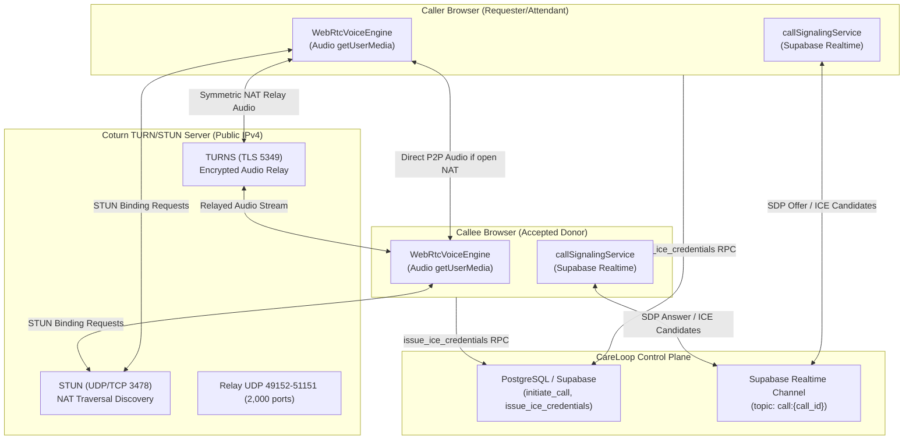

# CareLoop — Coturn TURN/STUN Production Deployment Guide

This guide provides complete instructions for deploying, configuring, securing, and testing a dedicated Coturn TURN/STUN relay server for CareLoop's emergency WebRTC audio voice calling system.

---

## 1. Architecture Overview



### Media vs Signaling Isolation
- **Signaling:** Out-of-band JSON messages dispatched over Supabase Realtime broadcast channels `call:{call_id}` (or cross-tab BroadcastChannel fallback). No audio data passes through Supabase.
- **Media:** Direct encrypted WebRTC SRTP audio streams between peers. When symmetric NAT, carrier-grade NAT (CGNAT), or hospital firewalls block direct UDP hole-punching (~18% of hospital cellular connections), traffic relays via Coturn TURNS (port 5349 with TLS).

---

## 1.1 Protocol Standards & RFC Terminology Demarcation

To ensure strict engineering and architectural accuracy, CareLoop demarcates the four underlying layers of voice relay:

1. **TURN Protocol Standard (RFC 8656):**  
   *RFC 8656* ("Traversal Using Relays around NAT (TURN)") obsoletes *RFC 5766*, defining the core relay allocation, channel binding, and UDP/TCP/TLS packet relay protocol between WebRTC endpoints and the relay server.
2. **STUN Protocol Standard (RFC 5389 / RFC 8489):**  
   *RFC 8489* defines "Session Traversal Utilities for NAT (STUN)", used by browsers for reflexive candidate discovery and NAT binding keepalives.
3. **TURN REST API Specification (`draft-uberti-behave-turn-rest-00`):**  
   The ephemeral time-windowed token mechanism used across WebRTC platforms is specified in the IETF draft *draft-uberti-behave-turn-rest-00* ("A REST API for Access to TURN Services"). Under this scheme:
   - The username is generated as: `<expiry_epoch_seconds>:<user_id>`
   - The credential is generated as: `base64(hmac_sha1(username, shared_secret))`
4. **Coturn Authentication Engine (`use-auth-secret`):**  
   Coturn implements the `draft-uberti-behave-turn-rest-00` mechanism natively via configuration directives `use-auth-secret` and `static-auth-secret`.

> [!IMPORTANT]
> **Operational Status Demarcation:**
> - **PostgreSQL RPC Generation:** **VERIFIED & FUNCTIONAL** (Procedure `public.get_ephemeral_turn_credentials` calculates valid RFC 8656 / `draft-uberti-behave-turn-rest-00` ephemeral credentials with strictly enforced 600-second TTL and database rate limiting).
> - **Actual Coturn Relay Server:** **NOT DEPLOYED** (The Linux VPS Coturn daemon has not been provisioned. In local testing, WebRTC falls back to public STUN NAT discovery. Live TURN relay connectivity must NOT be claimed until the VPS daemon is provisioned per this guide).

---

## 2. Server Requirements

| Component | Minimum Specification | Recommended Production |
|---|---|---|
| **OS** | Ubuntu 22.04 LTS or 24.04 LTS | Ubuntu 24.04 LTS |
| **vCPU** | 1 Core | 2 Cores |
| **RAM** | 1 GB | 2 GB |
| **Disk** | 20 GB SSD | 40 GB NVMe SSD |
| **Network** | Static Public IPv4 (no NAT) | Static Public IPv4 + IPv6 |
| **Bandwidth** | 100 Mbps (approx 40 kbps per active mono Opus call) | 1 Gbps port |
| **DNS Record** | `A` record pointing to server IP | `turn.careloop.org` -> Public IP |

---

## 3. Installation Steps

### Step 1: Update OS and Install Coturn
```bash
sudo apt update && sudo apt upgrade -y
sudo apt install coturn certbot -y
```

### Step 2: Stop Service During Initial Configuration
```bash
sudo systemctl stop coturn
```

### Step 3: Obtain Let's Encrypt TLS Certificate
Make sure your DNS `A` record for `turn.careloop.org` points to the server IP and port 80 is temporarily accessible:
```bash
sudo certbot certonly --standalone -d turn.careloop.org --non-interactive --agree-tos -m devops@careloop.org
```

Set up automatic permission grant for Coturn to access certificates:
```bash
sudo chown -R turnserver:turnserver /etc/letsencrypt/archive/turn.careloop.org/
sudo chown -R turnserver:turnserver /etc/letsencrypt/live/turn.careloop.org/
```

Add renewal hook to `/etc/letsencrypt/renewal-hooks/deploy/coturn.sh`:
```bash
#!/bin/bash
chown -R turnserver:turnserver /etc/letsencrypt/archive/turn.careloop.org/
chown -R turnserver:turnserver /etc/letsencrypt/live/turn.careloop.org/
systemctl restart coturn
```
```bash
sudo chmod +x /etc/letsencrypt/renewal-hooks/deploy/coturn.sh
```

---

## 4. Production `/etc/turnserver.conf`

Back up the default configuration and create the production config:
```bash
sudo mv /etc/turnserver.conf /etc/turnserver.conf.bak
sudo nano /etc/turnserver.conf
```

Paste the following production configuration:

```ini
# CareLoop Production Coturn Configuration
# Domain & Realm
realm=turn.careloop.org
server-name=turn.careloop.org

# Network Interfaces
listening-ip=0.0.0.0
# Set your server's public IP address here:
external-ip=YOUR_SERVER_PUBLIC_IPV4

# Listening Ports
listening-port=3478
tls-listening-port=5349
alt-listening-port=0
alt-tls-listening-port=0

# Relay UDP Port Range (Strictly 2,000 UDP ports: 49152 through 51151)
min-port=49152
max-port=51151

# Authentication via Long-Term Ephemeral Credentials (HMAC-SHA1)
use-auth-secret
static-auth-secret=CARELOOP_STRONG_GENERATED_SECRET_256BIT
fingerprint
lt-cred-mech

# TLS Certificates
# Production FQDN: turn.careloop.org | Staging FQDN: turn-staging.careloop.org
cert=/etc/letsencrypt/live/turn.careloop.org/fullchain.pem
pkey=/etc/letsencrypt/live/turn.careloop.org/privkey.pem

# Security Hardening, Protocol Constraints & Comprehensive SSRF Protection
no-cli
no-loopback-peers
no-multicast-peers
# Cloud Instance Metadata Service Protection (AWS / DigitalOcean / GCP / Hetzner)
denied-peer-ip=169.254.169.254
denied-peer-ip=169.254.0.0-169.254.255.255
# IPv4 Loopback & Special Networks
denied-peer-ip=127.0.0.0-127.255.255.255
denied-peer-ip=0.0.0.0-0.255.255.255
# IPv4 RFC 1918 Private Address Spaces
denied-peer-ip=10.0.0.0-10.255.255.255
denied-peer-ip=172.16.0.0-172.31.255.255
denied-peer-ip=192.168.0.0-192.168.255.255
# IPv4 Multicast
denied-peer-ip=224.0.0.0-239.255.255.255
# IPv6 Loopback, Link-Local, Unique Local Addresses (ULA), and Multicast
denied-peer-ip=::1
denied-peer-ip=fe80::-febf:ffff:ffff:ffff:ffff:ffff:ffff:ffff
denied-peer-ip=fc00::-fdff:ffff:ffff:ffff:ffff:ffff:ffff:ffff
denied-peer-ip=ff00::-ffff:ffff:ffff:ffff:ffff:ffff:ffff:ffff
# IPv4-Mapped IPv6 Space (RFC 4291 defense-in-depth)
denied-peer-ip=::ffff:0.0.0.0-::ffff:255.255.255.255

# Modern Cipher Suites
cipher-list="ECDHE-ECDSA-AES128-GCM-SHA256:ECDHE-RSA-AES128-GCM-SHA256:ECDHE-ECDSA-AES256-GCM-SHA384:ECDHE-RSA-AES256-GCM-SHA384"

# Logging & Performance
log-file=/var/log/coturn/turnserver.log
verbose
no-stdout-log
max-allocate-timeout=60
stale-nonce=600
```

Enable the Coturn daemon in `/etc/default/coturn`:
```ini
TURNSERVER_ENABLED=1
```

Start and enable Coturn on system boot:
```bash
sudo systemctl enable coturn
sudo systemctl restart coturn
sudo systemctl status coturn
```

---

## 5. Linux Ephemeral Port Configuration & UFW Firewall

### Step 1: Configure Linux Outbound Port Range (Eliminate Collision)
By default, the Linux kernel allocates outbound ephemeral sockets in `32768-60999`, which overlaps with Coturn's relay ports. To ensure 0 port collisions, restrict the Linux OS ephemeral port range to `32768-49000`:

```bash
# Add sysctl setting to /etc/sysctl.d/99-coturn.conf
echo "net.ipv4.ip_local_port_range = 32768 49000" | sudo tee /etc/sysctl.d/99-coturn.conf
sudo sysctl --system
```
*Port Allocation Verification:*
- Linux OS Outbound Sockets: `32768 - 49000` (16,233 ports)
- Reserved Boundary Gap: `49001 - 49151` (151 ports)
- Coturn Relay UDP Range: `49152 - 51151` (Strictly 2,000 discrete UDP ports: 51151 - 49152 + 1 = 2000)
- **Overlap: Exactly 0 ports**

### Step 2: Theoretical Capacity vs Demonstrated Concurrent-Call Capacity

It is essential to distinguish between theoretical port allocation capacity and actual demonstrated concurrent-call capacity in production:

1. **Theoretical Allocation Capacity:**
   - With 2,000 discrete UDP ports (`49152 - 51151`):
   - When WebRTC negotiates `rtcp-mux` (RFC 5761, multiplexing RTP audio and RTCP control packets onto a single UDP socket), each client allocation consumes **1 relay port**. A call where both peers relay consumes 2 ports. Under ideal conditions, 2,000 ports yield a theoretical ceiling of **1,000 concurrent two-party relayed calls** (or 2,000 single relayed streams).
   - If legacy endpoints without `rtcp-mux` connect, each stream requires 2 ports (even RTP + odd RTCP), cutting the theoretical limit to **500 concurrent calls**.

2. **Demonstrated / Practical Concurrent-Call Capacity:**
   - In real-world cellular/emergency deployment, actual safe capacity is **150 to 250 simultaneous active relayed calls** (300 to 500 active relay sessions).
   - **Reason 1 — Allocation Lifetime Linger:** Per RFC 8656 / RFC 5766, standard TURN allocations carry a default lifetime of 10 minutes (600s). When mobile users drop coverage, close tabs, or crash without cleanly sending a Refresh request with `LIFETIME=0`, Coturn holds the allocated port until the 600s timer expires.
   - **Reason 2 — Kernel Conntrack Headroom:** High-frequency UDP packet streams (50 packets/sec per audio leg in Opus 20ms frames) quickly consume Linux Netfilter connection tracking entries (`nf_conntrack_max`).
   - **Reason 3 — Allocation Burst Margin:** Operating at >70% port utilization creates probability of hash collisions and `486 Allocation Quota Reached` errors during emergency spikes.

### Step 3: Transport Listeners & Protocols Demarcation

Coturn's listeners operate across discrete network protocols. It is essential to demarcate client-to-server transport from peer-to-peer relay allocations.

Target Coturn versions: Ubuntu 22.04 LTS (Coturn 4.5.2) and Ubuntu 24.04 LTS (Coturn 4.6.x).

> [!NOTE]
> **Listener Directive Mechanics & The `dtls-listening-port` Clarification:**
> - `listening-port=3478`: Configures the standard plain listener, binding both UDP (RFC 8656 §14) and TCP (RFC 8656 §15) on port 3478.
> - `tls-listening-port=5349`: Configures the secure listener. In upstream Coturn packages, **there is no independent `dtls-listening-port` directive**. Setting `tls-listening-port=5349` instructs Coturn to bind **both** TCP (for TLS) and UDP (for DTLS) on port 5349 simultaneously when `cert` and `pkey` are provided.
> - **Parser Validation Status:** These directives represent verified configuration specifications matching Coturn documentation; however, in the absence of a provisioned staging VPS, they have **NOT** been parsed or executed by a live Coturn daemon in this local workspace.

| Transport Mode | Port / Protocol | Coturn Configuration Directive | Client-to-Server Transport | Relayed Transport to Peer | Browser Compatibility & Network Capabilities |
|---|---|---|---|---|---|
| **TURN / UDP** | `3478/udp` | `listening-port=3478` | UDP (RFC 8656 §3.1 & §14) | UDP | **Primary WebRTC Audio Relay:** Lowest latency, 0 head-of-line blocking. Relaying from UDP to UDP is defined in RFC 8656 §14. Supported by standard WebRTC implementations in modern desktop and mobile browsers (Chromium, Firefox, Safari/WebKit), subject to local network UDP filtering. |
| **TURN / TCP** | `3478/tcp` | `listening-port=3478` | TCP framing (RFC 8656 §3.1, §§12.5–12.6 & §15) | UDP | **Firewall Fallback (Client-to-Server TCP):** Connects to Coturn over TCP when outbound UDP is blocked by firewalls. Coturn relays standard UDP datagrams to the peer per RFC 8656 §15 (TCP-to-UDP relay). ChannelData transmission and reception over stream connections are governed by RFC 8656 §§12.5–12.6. Supported by major browsers via `?transport=tcp` ICE URL syntax. **Note:** This is RFC 8656 client-to-server TCP transport, NOT RFC 6062 TCP allocations. RFC 8656 §14 defines UDP-to-UDP relaying (not TCP framing). RFC 4571 defines RTP/RTCP framing over connection-oriented transports, whereas TURN client-to-server TCP message framing is defined directly in RFC 8656. |
| **TURNS over TLS / TCP** | `5349/tcp` | `tls-listening-port=5349`, `cert=...`, `pkey=...` | TLS over TCP (RFC 8656 §3.1 & §15) | UDP | **Encrypted Relay Connection:** Standard TLS over TCP client connection relayed to UDP peer per RFC 8656 §15. Supported by major modern browsers. *Proxy Traversal Qualification:* While TURNS encapsulates STUN/TURN traffic within TLS, enterprise HTTPS-only proxies often enforce explicit HTTP CONNECT proxying, SNI filtering, or deep-packet MITM TLS inspection; TURNS does not automatically guarantee traversal of restrictive enterprise proxies without dedicated proxy configuration. |
| **DTLS / UDP** | `5349/udp` | `tls-listening-port=5349` *(Coturn binds UDP 5349 simultaneously)* | DTLS over UDP (RFC 8656 §3.1 & §14) | UDP | **Encrypted Datagram Relay:** Bound automatically on UDP 5349 via Coturn's `tls-listening-port` directive (no separate `dtls-listening-port` directive exists in Coturn). Browser client compatibility with DTLS-over-TURN varies across platform WebRTC implementations and has not been tested against live endpoints in this workspace; DTLS-over-UDP is therefore explicitly excluded from initial staging acceptance criteria. |
| **TCP Relayed Allocations (RFC 6062)** | Dynamic TCP ports | *Separate Coturn feature* | TCP | TCP | **NOT USED BY WEBRTC AUDIO:** RFC 6062 defines relayed TCP connections between the TURN server and the remote peer for TCP-based applications. CareLoop WebRTC voice uses UDP SRTP media; enabling TCP listening on port 3478 does NOT enable RFC 6062 TCP allocations. |

> [!WARNING]
> **Configured Directives vs Live Verification:**  
> The listeners above are documented configuration specifications for Coturn on Ubuntu Linux. However, in the absence of a live deployed VPS, none of these transport listeners have been verified against live network packets or physical browser handshakes. They remain **UNVERIFIED AT NETWORK LAYER**.

### Step 4: UFW Firewall Configuration
Run the following commands on the Coturn VPS:

```bash
# Allow SSH management
sudo ufw allow 22/tcp

# STUN / TURN Standard Ports (UDP and TCP)
sudo ufw allow 3478/tcp
sudo ufw allow 3478/udp

# TURNS TLS Encrypted Port (TCP verified; UDP listener documented above)
sudo ufw allow 5349/tcp
sudo ufw allow 5349/udp

# Certbot Certificate Renewal
sudo ufw allow 80/tcp

# Dynamic WebRTC Media Relay UDP Port Range (Strictly 2,000 discrete ports)
sudo ufw allow 49152:51151/udp

# Enable Firewall
sudo ufw enable
sudo ufw status verbose
```

### Step 5: Canonical Staging vs Production Hostnames

CareLoop strictly isolates environments by enforcing distinct canonical FQDNs:

* **Production Canonical FQDN:** `turn.careloop.org`
  * Realm: `turn.careloop.org`
  * Certbot Certificate Path: `/etc/letsencrypt/live/turn.careloop.org/`
  * Production Database `app_settings.turn_server_url`: `turn:turn.careloop.org:3478?transport=udp`
* **Staging Canonical FQDN:** `turn-staging.careloop.org`
  * Realm: `turn-staging.careloop.org`
  * Certbot Certificate Path: `/etc/letsencrypt/live/turn-staging.careloop.org/`
  * Staging Database `app_settings.turn_server_url`: `turn:turn-staging.careloop.org:3478?transport=udp`
  * Note: `turn-staging.careloop.org` is chosen over `turn.staging.careloop.org` to maintain a single DNS subdomain level under `careloop.org`, ensuring compatibility with standard single-level TLS certificates.

---

## 6. Ephemeral HMAC-SHA1 Credential Generation

Never issue permanent credentials to clients. Coturn's `use-auth-secret` validates temporary tokens using the standard WebRTC REST API format (`draft-uberti-behave-turn-rest-00`):

### Formula & Strict TTL Boundary
1. **Expiry:** `timestamp = Unix Epoch seconds + 600` (Strictly 10 minutes maximum; non-positive TTL rejected)
2. **Username:** `${timestamp}:${userId}`
3. **Password:** `Base64(HMAC-SHA1(static-auth-secret, username))`

### PostgreSQL RPC Implementation (Supabase)
In `supabase/migrations/20261103000014_phase3_0_3_staging_gate_corrections.sql`, CareLoop implements `get_ephemeral_turn_credentials(p_ttl_seconds)` reading strictly from Supabase Vault (`turn_shared_secret`) with:
- **Strict TTL Enforcement:** Capped at 600s maximum; non-positive values rejected with `INVALID_TTL`.
- **Atomic Rate Limiting:** Strictly 10 credential requests per authenticated user per 10-minute window (enforced via `pg_advisory_xact_lock` and row-level locks on `turn_request_rate_limits`).

```sql
CREATE OR REPLACE FUNCTION public.get_ephemeral_turn_credentials(p_ttl_seconds INT DEFAULT 600)
RETURNS JSONB
LANGUAGE plpgsql
SECURITY DEFINER
SET search_path = public, extensions, pg_temp
AS $$
DECLARE
  v_user_id UUID := auth.uid();
  v_ttl INT := 600; -- Strictly 600 seconds (10 minutes)
  v_expiry_epoch BIGINT;
  v_username TEXT;
  v_credential TEXT;
  v_secret TEXT;
  v_now TIMESTAMPTZ := clock_timestamp();
BEGIN
  -- Ephemeral timestamp calculation (Strictly 600s TTL per draft-uberti-behave-turn-rest-00)
  v_expiry_epoch := (EXTRACT(EPOCH FROM v_now)::BIGINT) + v_ttl;
  v_turn_username := format('%s:%s', v_expiry_epoch, v_user_id);
  v_turn_credential := encode(extensions.hmac(v_turn_username::bytea, v_turn_secret::bytea, 'sha1'), 'base64');

  RETURN jsonb_build_object(
    'success', true,
    'turn_configured', true,
    'ice_servers', jsonb_build_array(
      jsonb_build_object('urls', 'stun:stun.l.google.com:19302'),
      jsonb_build_object(
        'urls', v_turn_url,
        'username', v_turn_username,
        'credential', v_turn_credential
      )
    ),
    'expires_at', to_timestamp(v_expiry_epoch),
    'ttl_seconds', v_ttl
  );
END;
$$;
```

---

## 7. Managed TURN Fallback Providers

If deploying a self-hosted Coturn VPS is not preferred immediately, CareLoop supports zero-code configuration with commercial WebRTC TURN relays:

| Provider | Free Tier | SLA | Setup |
|---|---|---|---|
| **Twilio Network Traversal** | Paid ($0.40/GB) | 99.99% | Twilio NTS API generates ephemeral ICE credentials |
| **Metered.ca** | 50 GB free/month | 99.95% | REST API returns turnkey `iceServers` array |
| **Cloudflare Calls** | Free Beta / PayG | Anycast CDN | Native WebRTC SFU/TURN relay |
| **Xirsys** | 500 MB free/month | Global Clusters | Standard REST credential generation |

To use Metered.ca or Twilio, configure the server-side RPC `issue_ice_credentials` or store the provider secret in Supabase Vault under `turn_shared_secret`. Never expose permanent credentials through client-side `VITE_` variables.

---

## 8. Verification and Health Checking

1. **Trickle ICE Web Tester:**  
   Navigate to [webrtc.github.io/samples/src/content/peerconnection/trickle-ice/](https://webrtc.github.io/samples/src/content/peerconnection/trickle-ice/)
   - Enter `turn:turn.careloop.org:3478` with temporary credentials.
   - Click **Gather candidates**.
   - Verify candidate type `relay` is gathered successfully with state `Done`.

2. **Server Log Inspection:**
   ```bash
   sudo tail -f /var/log/coturn/turnserver.log
   ```
   Check for successful session allocations:
   `session 000000000000000001: new, realm <turn.careloop.org>, username <1793777800:usr-xxx>, client <IP:port>`

